# C++ Learning Modules

[](https://en.cppreference.com/) [](#learning-roadmap) [](#learning-modules--subtopics) [](#learning-modules--subtopics) [](#prerequisites) [](./LICENSE)

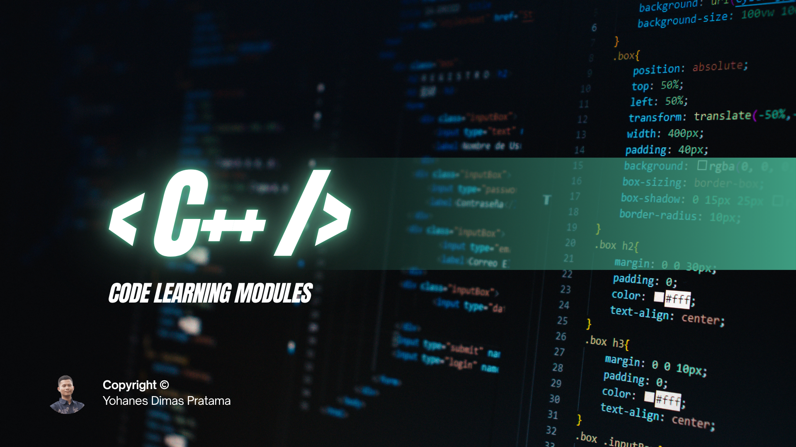

## Project Description

**C++ Learning Modules** is a comprehensive, production-grade educational curriculum designed to guide learners from fundamental programming concepts through modern C++20 paradigms, low-level memory mechanics, object-oriented software engineering, classical algorithms, and full-featured terminal applications.

Structured across **17 pedagogical modules** containing **250 fully standalone and compilable C++ programs**, this repository bridges theory and practice. Each lesson is paired with its verified terminal execution output capture rendered directly from executed processes, guaranteeing reproducible behavior across development environments. Whether learning C++ as a first language, transitioning from another systems language, or mastering modern standards (C++17/C++20), this repository provides an exhaustive, hands-on, code-first curriculum.

## Learning Objectives

Learners working through this curriculum will develop concrete, industry-ready systems programming skills across every stage of C++ development:

- **Core Syntax & Stream I/O**: Master program anatomy, stream extraction/insertion, preprocessor directives, formatted output (`<iomanip>`), and compiler warning resolution.
- **Type System & Immutability**: Leverage static typing, uniform initialization, type casting (`static_cast`), compile-time evaluation (`constexpr`), and type inference (`auto`).
- **Control Flow & Decision Logic**: Implement single/multi-branch conditionals, `switch-case` dispatching, loops (`for`, `while`, `do-while`), and complex nesting patterns.
- **Modular Function Design**: Design reusable functions using pass-by-value, pass-by-reference, pass-by-const-reference, recursion, function pointers, and modern lambda expressions.
- **Memory Management & Pointers**: Understand memory addressing, pointer arithmetic, manual heap management (`new`/`delete`), and master modern RAII idioms and smart pointers (`std::unique_ptr`, `std::shared_ptr`, `std::weak_ptr`).
- **User-Defined Data Types**: Architect composite types using structures (`struct`), scoped enumerations (`enum class`), unions, and clean type aliases (`using`).
- **Object-Oriented Architecture**: Construct robust software using encapsulation, constructors/destructors, member initializer lists, operator overloading, inheritance hierarchies, runtime polymorphism, virtual functions, and abstract interfaces.
- **Standard Template Library (STL)**: Utilize standard containers (`vector`, `list`, `deque`, `stack`, `queue`, `priority_queue`, `set`, `map`, `unordered_map`), iterators, and generic algorithm pipelines (`std::sort`, `std::transform`, `std::accumulate`).
- **Generic Programming & Templates**: Author generic functions, class templates, full/partial template specializations, variadic templates, and C++20 concepts (`std::integral`).
- **File Persistence & Exception Handling**: Build resilient applications with disk file streams (`std::ifstream`, `std::ofstream`), CSV parsers, structured `try-catch` blocks, and custom exception hierarchies.
- **Algorithms & Data Structures**: Implement fundamental computer science algorithms from scratch, including sorting (bubble, selection, insertion, merge, quick sort), searches (linear, binary), linked lists, binary search trees, hash tables, graph traversals (BFS, DFS), backtracking, and dynamic programming.
- **Modern C++ Features**: Write idiomatic C++17 and C++20 code using structured bindings, `std::optional`, `std::variant`, `std::filesystem`, `std::chrono`, move semantics, rvalue references, perfect forwarding, multithreading (`std::thread`, `std::mutex`), ranges, and coroutines.
- **Code Quality, Testing & Architecture**: Practice defensive programming using assertions, unit tests, boundary testing, memory sanitizer integration, refactoring, header-source separation, and multi-file builds.
- **Capstone Project Engineering**: Consolidate technical knowledge by constructing 10 complete terminal applications and business domain simulations.

## Learning Roadmap

The curriculum follows a carefully designed pedagogical trajectory progressing from foundational syntax to advanced systems engineering:

| Module | Title | Level | Topics | Primary Focus |
| :--- | :--- | :--- | :---: | :--- |
| [01. Introduction to C++ and Program Structure](#module-01-introduction-to-c-and-program-structure) | Introduction to C++ and Program Structure | `Fundamental` | 10 (1–10) | Establishes a solid foundation in C++ programming fundamentals, including source code anat... |
| [02. Variables and Data Types](#module-02-variables-and-data-types) | Variables and Data Types | `Fundamental` | 14 (11–24) | Covers C++ static typing mechanisms, fundamental primitive types (integers, floats, double... |
| [03. Input, Output, and Operators](#module-03-input-output-and-operators) | Input, Output, and Operators | `Fundamental` | 14 (25–38) | Explores terminal stream extraction and manipulation, arithmetic, relational, logical, and... |
| [04. Control Flow and Decision Making](#module-04-control-flow-and-decision-making) | Control Flow and Decision Making | `Fundamental` | 10 (39–48) | Examines conditional branching structures including `if`, `else-if`, `else`, nested decisi... |
| [05. Loops and Iterations](#module-05-loops-and-iterations) | Loops and Iterations | `Fundamental` | 15 (49–63) | Focuses on iterative control flow using `for`, `while`, and `do-while` loops, nested loops... |
| [06. Functions and Scope](#module-06-functions-and-scope) | Functions and Scope | `Intermediate` | 15 (64–78) | Dives into modular program architecture, function prototypes, value vs. reference paramete... |
| [07. Arrays, Strings, and Data Collections](#module-07-arrays-strings-and-data-collections) | Arrays, Strings, and Data Collections | `Intermediate` | 19 (79–97) | Covers contiguous memory storage and text handling, including fixed-size arrays, multi-dim... |
| [08. Pointers and Memory Management](#module-08-pointers-and-memory-management) | Pointers and Memory Management | `Intermediate to Advanced` | 15 (98–112) | Examines low-level memory addressing, pointer arithmetic, manual heap management (`new`/`d... |
| [09. User-Defined Data Structures](#module-09-user-defined-data-structures) | User-Defined Data Structures | `Intermediate` | 9 (113–121) | Covers custom composite data types, including C++ structures (`struct`), arrays of structs... |
| [10. Object-Oriented Programming (OOP)](#module-10-object-oriented-programming-oop) | Object-Oriented Programming (OOP) | `Intermediate to Advanced` | 26 (122–147) | Provides comprehensive coverage of object-oriented principles: encapsulation, constructors... |
| [11. Standard Template Library (STL)](#module-11-standard-template-library-stl) | Standard Template Library (STL) | `Intermediate to Advanced` | 23 (148–170) | Explores the C++ Standard Template Library, covering sequence containers (`vector`, `list`... |
| [12. Templates and Generic Programming](#module-12-templates-and-generic-programming) | Templates and Generic Programming | `Advanced` | 9 (171–179) | Covers compile-time polymorphism and generic software design: function templates, class te... |
| [13. File Handling and Exception Handling](#module-13-file-handling-and-exception-handling) | File Handling and Exception Handling | `Intermediate to Advanced` | 12 (180–191) | Covers persistent stream I/O and fault-tolerant software engineering: reading, writing, an... |
| [14. Algorithms and Data Structures](#module-14-algorithms-and-data-structures) | Algorithms and Data Structures | `Advanced` | 19 (192–210) | Implements foundational data structures and classical algorithms from scratch: linear/bina... |
| [15. Modern C++ and Advanced Features](#module-15-modern-c-and-advanced-features) | Modern C++ and Advanced Features | `Advanced` | 18 (211–228) | Explores modern C++ standards (C++17/C++20): structured bindings, `std::optional`, `std::v... |
| [16. Debugging, Testing, and Code Quality](#module-16-debugging-testing-and-code-quality) | Debugging, Testing, and Code Quality | `Intermediate to Advanced` | 12 (229–240) | Covers software verification and engineering discipline: console debugging, assertions, un... |
| [17. Practical Capstone Projects](#module-17-practical-capstone-projects) | Practical Capstone Projects | `Capstone / Practical` | 10 (241–250) | Consolidates curriculum knowledge into 10 real-world terminal capstone projects: calculato... |

## Prerequisites

Before getting started with the curriculum, ensure your environment meets the following baseline requirements:

- **Prior Knowledge**: Basic familiarity with fundamental programming principles (variables, conditions, loops) is helpful but not strictly required. The curriculum begins with fundamental concepts.
- **C++20 Compatible Compiler**:
  - **Microsoft Visual C++ (MSVC)**: Visual Studio 2019/2022 Build Tools (v19.29+ / v19.30+) with `/std:c++20` support.
  - **GNU Compiler Collection (GCC / g++)**: Version 10.0 or higher with `-std=c++20` support.
  - **LLVM Clang (clang++)**: Version 12.0 or higher with `-std=c++20` support.
- **Command Shell**: Windows PowerShell, Command Prompt (or Developer Command Prompt for VS), or Unix-compatible shells (Bash, Zsh) on Linux or macOS.
- **Text Editor or IDE**: Visual Studio Code, Visual Studio 2022, CLion, or any standard text editor.

## Tech Stack & Tools

- **Core Language**: C++ (C++20 Standard)
- **Standard Library Headers**: `<iostream>`, `<vector>`, `<string>`, `<memory>`, `<algorithm>`, `<cmath>`, `<iomanip>`, `<map>`, `<set>`, `<unordered_map>`, `<thread>`, `<mutex>`, `<future>`, `<filesystem>`, `<chrono>`, `<concepts>`, `<variant>`, `<optional>`, `<ranges>`
- **Supported Compilers**: MSVC (`cl.exe`), GCC (`g++`), Clang (`clang++`)
- **Build Environments**: Developer Command Prompt for Visual Studio, Windows PowerShell, Linux/macOS Terminal
- **Testing & Diagnostics**: Runtime assertions (`<cassert>`), AddressSanitizer (`/fsanitize=address` / `-fsanitize=address`)

## Getting Started

Follow these steps to clone the repository and verify your local compilation toolchain:

### 1. Clone the Repository

```bash
git clone https://github.com/weztcy/CPP-Learning-Modules.git
cd CPP-Learning-Modules
```

### 2. Verify Your Compiler

Check that a C++20 compliant compiler is available in your terminal path:

- **MSVC** (run from Developer Command Prompt for VS):
  ```cmd
  cl
  ```
- **GCC**:
  ```bash
  g++ --version
  ```
- **Clang**:
  ```bash
  clang++ --version
  ```

### 3. Build and Run a Sample Program

- **Using MSVC (Windows)**:
  ```cmd
  cl /nologo /std:c++20 /EHsc /W4 /utf-8 /Fe:"%TEMP%\latihan.exe" module-01-pengenalan-cpp-dan-struktur-program\01_hello_world.cpp
  "%TEMP%\latihan.exe"
  ```
- **Using GCC / Clang (Linux / macOS)**:
  ```bash
  g++ -std=c++20 -Wall -Wextra -pedantic module-01-pengenalan-cpp-dan-struktur-program/01_hello_world.cpp -o /tmp/latihan
  /tmp/latihan
  ```

## How to Use This Repository

To maximize learning effectiveness, follow this structured study workflow:

1. **Select a Module**: Review the [Learning Roadmap](#learning-roadmap) and pick the module matching your current skill level or topic of interest.
2. **Study the Concept**: Read the module overview and subtopic descriptions to understand the architectural concept and expected behavior.
3. **Inspect the Source Code**: Open the linked `.cpp` file in your editor. Review how classes, templates, algorithms, or standard library features are implemented.
4. **Compile and Run**: Compile the standalone `.cpp` program using the provided command instructions. Each lesson contains its own `main()` entry point.
5. **Compare Execution Output**: Verify your terminal output against the bundled execution screenshot in that subtopic's `output/` folder.
6. **Experiment and Practice**: Modify variables, explore edge cases, intentionally trigger compiler diagnostics, and complete the capstone projects in Module 17.

## Learning Modules & Subtopics

This section contains the comprehensive curriculum breakdown across all 17 modules and 250 subtopics. Each subtopic includes a verified link to its source code, key concepts, technical explanation, and rendered terminal execution capture.

### Module 01: Introduction to C++ and Program Structure

**Curriculum Path**: [`module-01-pengenalan-cpp-dan-struktur-program`](./module-01-pengenalan-cpp-dan-struktur-program) | **Level**: `Fundamental` | **Scope**: 10 Programs

#### Overview & Concepts Covered

Establishes a solid foundation in C++ programming fundamentals, including source code anatomy, preprocessor directives, console stream output, compiler diagnostics, and namespace management.

#### Subtopics & Execution Captures

##### 1. First C++ Program

- **Source Code**: [`01_hello_world.cpp`](./module-01-pengenalan-cpp-dan-struktur-program/01_hello_world.cpp)
- **Key Concept**: Program entry point and standard console output.
- **Mechanism**: Calls std::cout from <iostream> to print the initial greeting to the console.
- **Execution Output**:

  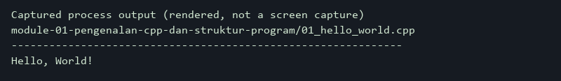

##### 2. Basic Program Structure

- **Source Code**: [`02_struktur_program.cpp`](./module-01-pengenalan-cpp-dan-struktur-program/02_struktur_program.cpp)
- **Key Concept**: Anatomy of a standard C++ executable.
- **Mechanism**: Includes standard headers, defines the main() entry point, and returns 0 to signal successful execution.
- **Execution Output**:

  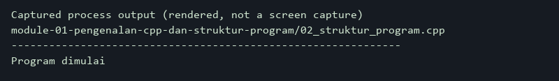

##### 3. Single-Line and Multi-Line Comments

- **Source Code**: [`03_komentar.cpp`](./module-01-pengenalan-cpp-dan-struktur-program/03_komentar.cpp)
- **Key Concept**: Source code documentation syntax.
- **Mechanism**: Demonstrates single-line (//) and multi-line (/* ... */) comments ignored by the compiler while executing active print statements.
- **Execution Output**:

  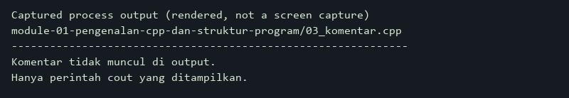

##### 4. Escape Sequences

- **Source Code**: [`04_escape_sequences.cpp`](./module-01-pengenalan-cpp-dan-struktur-program/04_escape_sequences.cpp)
- **Key Concept**: Special character formatting in string literals.
- **Mechanism**: Uses escape sequences including \n (newline), \t (tab), quotes, and backslashes to format terminal text.
- **Execution Output**:

  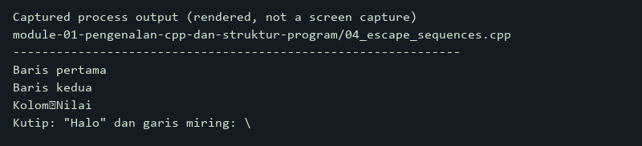

##### 5. Console Output with cout

- **Source Code**: [`05_output_cout.cpp`](./module-01-pengenalan-cpp-dan-struktur-program/05_output_cout.cpp)
- **Key Concept**: Stream insertion operator chaining.
- **Mechanism**: Chains the << stream insertion operator to output concatenated text strings and numeric values without manual conversion.
- **Execution Output**:

  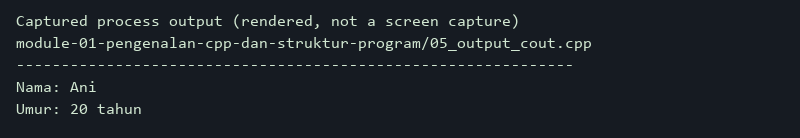

##### 6. Namespaces and std

- **Source Code**: [`06_namespace_std.cpp`](./module-01-pengenalan-cpp-dan-struktur-program/06_namespace_std.cpp)
- **Key Concept**: Scope qualification with standard library symbols.
- **Mechanism**: Uses the std:: namespace prefix to access cout and endl directly without importing the entire global namespace.
- **Execution Output**:

  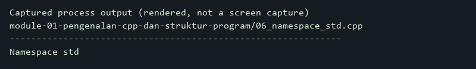

##### 7. Output Formatting

- **Source Code**: [`07_format_output.cpp`](./module-01-pengenalan-cpp-dan-struktur-program/07_format_output.cpp)
- **Key Concept**: Field width and floating-point precision formatting.
- **Mechanism**: Applies std::setw to align text columns and combines std::fixed with std::setprecision to format numbers to two decimal places.
- **Execution Output**:

  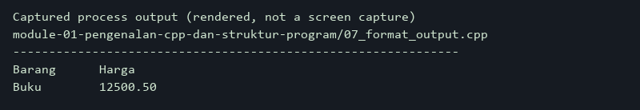

##### 8. Identifying Syntax Errors

- **Source Code**: [`08_compile_error.cpp`](./module-01-pengenalan-cpp-dan-struktur-program/08_compile_error.cpp)
- **Key Concept**: Compiler diagnostics and missing syntax identification.
- **Mechanism**: Demonstrates syntax error recognition by commenting out intentional compiler errors such as missing semicolons.
- **Execution Output**:

  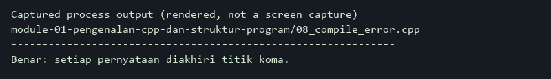

##### 9. Compiler Warnings

- **Source Code**: [`09_warning_compiler.cpp`](./module-01-pengenalan-cpp-dan-struktur-program/09_warning_compiler.cpp)
- **Key Concept**: High-warning compilation and unused variable flags.
- **Mechanism**: Demonstrates compiler warning detection (/W4) on unused variables and shows how referencing them resolves diagnostics.
- **Execution Output**:

  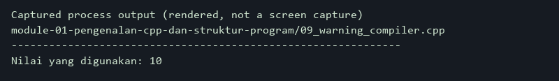

##### 10. Preprocessor Directives and Headers

- **Source Code**: [`10_preprocessor.cpp`](./module-01-pengenalan-cpp-dan-struktur-program/10_preprocessor.cpp)
- **Key Concept**: Header inclusion and macro substitutions.
- **Mechanism**: Demonstrates the #include directive for header definitions and the #define preprocessor macro replacement prior to compilation.
- **Execution Output**:

  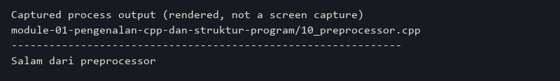

### Module 02: Variables and Data Types

**Curriculum Path**: [`module-02-variabel-dan-tipe-data`](./module-02-variabel-dan-tipe-data) | **Level**: `Fundamental` | **Scope**: 14 Programs

#### Overview & Concepts Covered

Covers C++ static typing mechanisms, fundamental primitive types (integers, floats, doubles, characters, booleans), standard strings, immutability with const and constexpr, explicit type casting, type deduction, variable scope, and machine numeric limits.

#### Subtopics & Execution Captures

##### 11. Variable Declaration

- **Source Code**: [`11_variable.cpp`](./module-02-variabel-dan-tipe-data/11_variable.cpp)
- **Key Concept**: Type specification and memory allocation.
- **Mechanism**: Declares an integer variable for age, assigns an initial value, and prints it to standard output.
- **Execution Output**:

  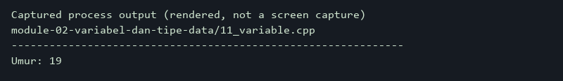

##### 12. Variable Initialization

- **Source Code**: [`12_variable_initialization.cpp`](./module-02-variabel-dan-tipe-data/12_variable_initialization.cpp)
- **Key Concept**: Assignment vs. brace initialization semantics.
- **Mechanism**: Compares copy initialization (=) with uniform brace initialization ({}) across int and double types.
- **Execution Output**:

  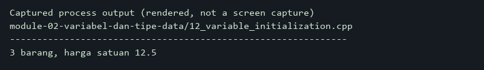

##### 13. Integer Data Types

- **Source Code**: [`13_integer_types.cpp`](./module-02-variabel-dan-tipe-data/13_integer_types.cpp)
- **Key Concept**: Width and sign variations of integral types.
- **Mechanism**: Demonstrates short, int, long, long long, and unsigned integer modifiers with their respective value representations.
- **Execution Output**:

  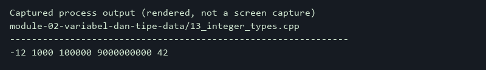

##### 14. Floating-Point Types (float and double)

- **Source Code**: [`14_floating_point.cpp`](./module-02-variabel-dan-tipe-data/14_floating_point.cpp)
- **Key Concept**: Single vs. double precision representation.
- **Mechanism**: Demonstrates differences in precision and significant digits between float and double using std::setprecision.
- **Execution Output**:

  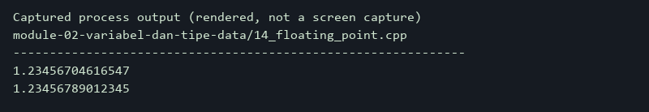

##### 15. Character Data Type (char)

- **Source Code**: [`15_char_data_type.cpp`](./module-02-variabel-dan-tipe-data/15_char_data_type.cpp)
- **Key Concept**: Single character and escape byte storage.
- **Mechanism**: Stores individual ASCII characters and newline escape literals within single-byte char variables.
- **Execution Output**:

  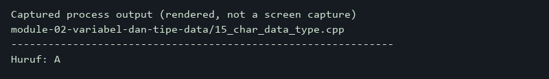

##### 16. Boolean Data Type (bool)

- **Source Code**: [`16_boolean.cpp`](./module-02-variabel-dan-tipe-data/16_boolean.cpp)
- **Key Concept**: Truth values and stream formatting.
- **Mechanism**: Stores boolean true/false states and utilizes std::boolalpha to render textual representations instead of 1/0 integers.
- **Execution Output**:

  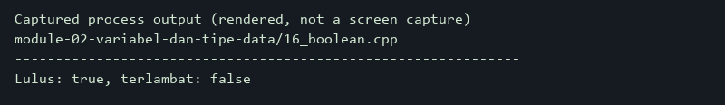

##### 17. String Data Type (std::string)

- **Source Code**: [`17_string_basic.cpp`](./module-02-variabel-dan-tipe-data/17_string_basic.cpp)
- **Key Concept**: Dynamic text sequences and output integration.
- **Mechanism**: Stores text strings within std::string and concatenates them with console output streams.
- **Execution Output**:

  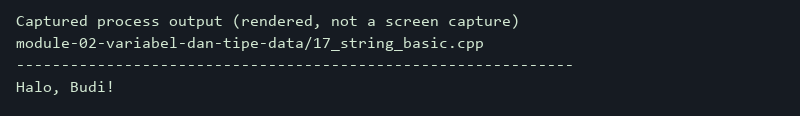

##### 18. Constant Variables (const)

- **Source Code**: [`18_constant_const.cpp`](./module-02-variabel-dan-tipe-data/18_constant_const.cpp)
- **Key Concept**: Runtime immutability enforcement.
- **Mechanism**: Protects variables from subsequent modification using the const qualifier and uses them in geometric formulas.
- **Execution Output**:

  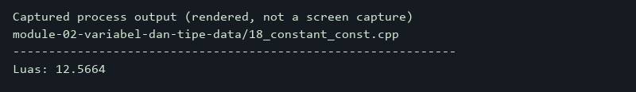

##### 19. Compile-Time Constants (constexpr)

- **Source Code**: [`19_constant_constexpr.cpp`](./module-02-variabel-dan-tipe-data/19_constant_constexpr.cpp)
- **Key Concept**: Compile-time evaluation and constant expressions.
- **Mechanism**: Computes compile-time constant array dimensions with constexpr and inspects allocated memory size with sizeof.
- **Execution Output**:

  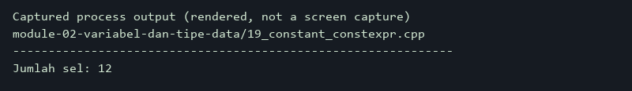

##### 20. Data Type Conversion

- **Source Code**: [`20_type_conversion.cpp`](./module-02-variabel-dan-tipe-data/20_type_conversion.cpp)
- **Key Concept**: Implicit numeric type promotion.
- **Mechanism**: Demonstrates implicit type promotion when dividing an integer by a floating-point literal to preserve fractional precision.
- **Execution Output**:

  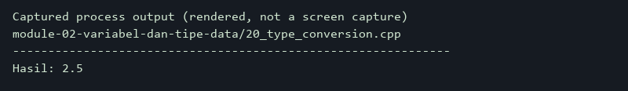

##### 21. Explicit Type Casting

- **Source Code**: [`21_type_casting.cpp`](./module-02-variabel-dan-tipe-data/21_type_casting.cpp)
- **Key Concept**: Safe type conversion using static_cast.
- **Mechanism**: Applies static_cast<double> to cast an integer operand prior to division, preventing truncation to integer arithmetic.
- **Execution Output**:

  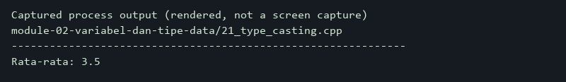

##### 22. Type Inference with auto

- **Source Code**: [`22_auto_keyword.cpp`](./module-02-variabel-dan-tipe-data/22_auto_keyword.cpp)
- **Key Concept**: Automatic compiler type deduction.
- **Mechanism**: Deduces variable types automatically from integer and floating-point literals using the auto keyword and computes their product.
- **Execution Output**:

  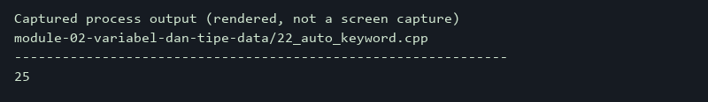

##### 23. Local and Global Scope

- **Source Code**: [`23_scope_variable.cpp`](./module-02-variabel-dan-tipe-data/23_scope_variable.cpp)
- **Key Concept**: Variable lifetime and lexical visibility.
- **Mechanism**: Contrasts file-level global variables with function-level local variables within main(), accessing them without shadowing.
- **Execution Output**:

  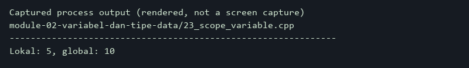

##### 24. Data Type Numeric Limits

- **Source Code**: [`24_numeric_limits.cpp`](./module-02-variabel-dan-tipe-data/24_numeric_limits.cpp)
- **Key Concept**: Hardware type boundaries via numeric_limits.
- **Mechanism**: Queries std::numeric_limits to inspect maximum integer values and floating-point precision digits on the current platform.
- **Execution Output**:

  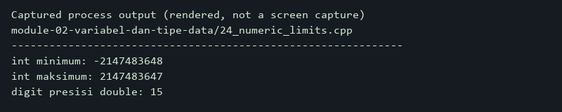

### Module 03: Input, Output, and Operators

**Curriculum Path**: [`module-03-input-output-dan-operator`](./module-03-input-output-dan-operator) | **Level**: `Fundamental` | **Scope**: 14 Programs

#### Overview & Concepts Covered

Explores terminal stream extraction and manipulation, arithmetic, relational, logical, and bitwise operators, operator precedence, mathematical routines from `<cmath>`, and formatted stream output using `<iomanip>`.

#### Subtopics & Execution Captures

##### 25. Console Input with cin

- **Source Code**: [`25_input_cin.cpp`](./module-03-input-output-dan-operator/25_input_cin.cpp)
- **Key Concept**: Stream extraction for formatted input.
- **Mechanism**: Reads an integer from standard input via cin and checks for stream extraction failures.
- **Execution Output**:

  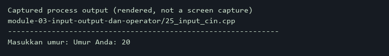

##### 26. Text Line Input with getline

- **Source Code**: [`26_input_getline.cpp`](./module-03-input-output-dan-operator/26_input_getline.cpp)
- **Key Concept**: Unformatted whitespace-preserving string input.
- **Mechanism**: Reads an entire line of text including whitespace characters using std::getline to capture full names.
- **Execution Output**:

  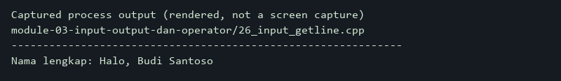

##### 27. Basic Input Validation

- **Source Code**: [`27_input_validation.cpp`](./module-03-input-output-dan-operator/27_input_validation.cpp)
- **Key Concept**: Input stream error checking and bounds validation.
- **Mechanism**: Validates stream state and enforces acceptable numerical ranges (0–100) to reject non-numeric and out-of-range inputs.
- **Execution Output**:

  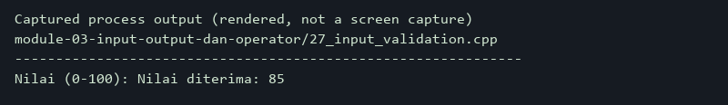

##### 28. Arithmetic Operators

- **Source Code**: [`28_arithmetic_operators.cpp`](./module-03-input-output-dan-operator/28_arithmetic_operators.cpp)
- **Key Concept**: Fundamental mathematical operations.
- **Mechanism**: Performs addition, subtraction, multiplication, and division, highlighting integer truncation versus floating-point results.
- **Execution Output**:

  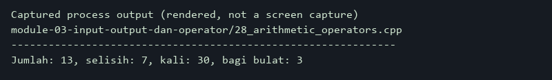

##### 29. Assignment Operators

- **Source Code**: [`29_assignment_operators.cpp`](./module-03-input-output-dan-operator/29_assignment_operators.cpp)
- **Key Concept**: Compound assignment expressions.
- **Mechanism**: Demonstrates compound assignment operators (+=, *=) to mutate variables concisely in place.
- **Execution Output**:

  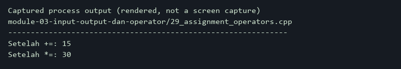

##### 30. Comparison Operators

- **Source Code**: [`30_comparison_operators.cpp`](./module-03-input-output-dan-operator/30_comparison_operators.cpp)
- **Key Concept**: Relational evaluation producing boolean results.
- **Mechanism**: Evaluates equality (==, !=) and ordering (<, >=) operators, displaying boolean outcomes formatted with std::boolalpha.
- **Execution Output**:

  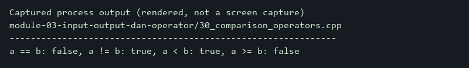

##### 31. Logical Operators

- **Source Code**: [`31_logical_operators.cpp`](./module-03-input-output-dan-operator/31_logical_operators.cpp)
- **Key Concept**: Compound boolean evaluations.
- **Mechanism**: Combines multiple relational conditions using logical AND (&&), OR (||), and NOT (!) operators.
- **Execution Output**:

  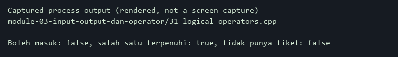

##### 32. Increment and Decrement Operators

- **Source Code**: [`32_increment_decrement.cpp`](./module-03-input-output-dan-operator/32_increment_decrement.cpp)
- **Key Concept**: Prefix vs. postfix evaluation semantics.
- **Mechanism**: Illustrates prefix (--x) decrementing before evaluation and postfix (x++) evaluating before incrementing.
- **Execution Output**:

  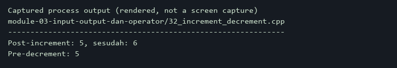

##### 33. Modulus Operator

- **Source Code**: [`33_modulus_operator.cpp`](./module-03-input-output-dan-operator/33_modulus_operator.cpp)
- **Key Concept**: Remainder calculation and parity checking.
- **Mechanism**: Applies the % modulus operator to extract division remainders and evaluate number parity (even/odd).
- **Execution Output**:

  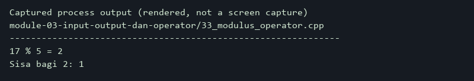

##### 34. Operator Precedence

- **Source Code**: [`34_operator_precedence.cpp`](./module-03-input-output-dan-operator/34_operator_precedence.cpp)
- **Key Concept**: Evaluation hierarchy and grouping with parentheses.
- **Mechanism**: Demonstrates precedence hierarchies between multiplication and addition, showing explicit override using parentheses.
- **Execution Output**:

  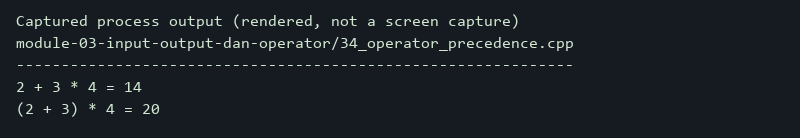

##### 35. Ternary Conditional Operator

- **Source Code**: [`35_ternary_operator.cpp`](./module-03-input-output-dan-operator/35_ternary_operator.cpp)
- **Key Concept**: Inline conditional value selection.
- **Mechanism**: Evaluates age conditions within a single-line ternary expression (? :) to select appropriate output strings.
- **Execution Output**:

  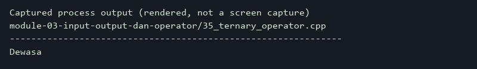

##### 36. Bitwise Operators

- **Source Code**: [`36_bitwise_operators.cpp`](./module-03-input-output-dan-operator/36_bitwise_operators.cpp)
- **Key Concept**: Low-level binary bit manipulations.
- **Mechanism**: Applies bitwise AND (&), OR (|), XOR (^), and bit shifts (<<, >>) to unsigned integer bit representations.
- **Execution Output**:

  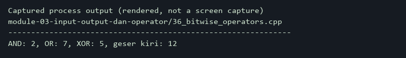

##### 37. Mathematical Functions

- **Source Code**: [`37_math_functions.cpp`](./module-03-input-output-dan-operator/37_math_functions.cpp)
- **Key Concept**: Common mathematical algorithms from <cmath>.
- **Mechanism**: Computes square roots (sqrt), powers (pow), and nearest integer roundings (round) using standard library routines.
- **Execution Output**:

  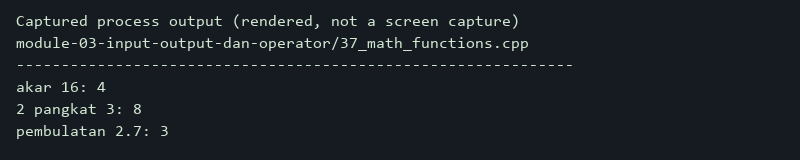

##### 38. Numeric Formatting with iomanip

- **Source Code**: [`38_iomanip_formatting.cpp`](./module-03-input-output-dan-operator/38_iomanip_formatting.cpp)
- **Key Concept**: Column alignment and fixed decimal formatting.
- **Mechanism**: Uses std::setw to define columnar widths and std::fixed with std::setprecision to enforce decimal formatting.
- **Execution Output**:

  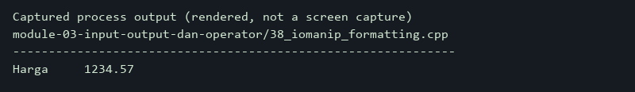

### Module 04: Control Flow and Decision Making

**Curriculum Path**: [`module-04-percabangan-dan-pengambilan-keputusan`](./module-04-percabangan-dan-pengambilan-keputusan) | **Level**: `Fundamental` | **Scope**: 10 Programs

#### Overview & Concepts Covered

Examines conditional branching structures including `if`, `else-if`, `else`, nested decisions, `switch-case` dispatching, and ternary expressions applied to practical problem solving.

#### Subtopics & Execution Captures

##### 39. If Statement

- **Source Code**: [`39_if_statement.cpp`](./module-04-percabangan-dan-pengambilan-keputusan/39_if_statement.cpp)
- **Key Concept**: Single-branch conditional execution.
- **Mechanism**: Executes conditional code blocks only when a numeric test score meets or exceeds the passing threshold.
- **Execution Output**:

  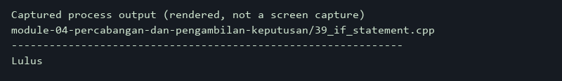

##### 40. If-Else Statement

- **Source Code**: [`40_if_else.cpp`](./module-04-percabangan-dan-pengambilan-keputusan/40_if_else.cpp)
- **Key Concept**: Binary branch selection.
- **Mechanism**: Evaluates temperature values to route execution mutually exclusively between two distinct program paths.
- **Execution Output**:

  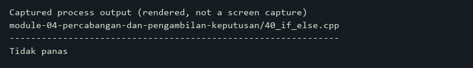

##### 41. Else-If Ladder

- **Source Code**: [`41_else_if.cpp`](./module-04-percabangan-dan-pengambilan-keputusan/41_else_if.cpp)
- **Key Concept**: Multi-condition evaluation chain.
- **Mechanism**: Evaluates numeric scores in descending order to assign appropriate letter grades from A down to E.
- **Execution Output**:

  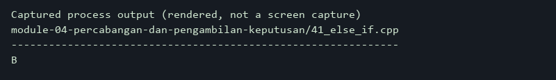

##### 42. Nested If Statements

- **Source Code**: [`42_nested_if.cpp`](./module-04-percabangan-dan-pengambilan-keputusan/42_nested_if.cpp)
- **Key Concept**: Hierarchical conditional validation.
- **Mechanism**: Performs hierarchical checks by first verifying ticket possession and subsequently evaluating age constraints.
- **Execution Output**:

  

##### 43. Switch-Case Statement

- **Source Code**: [`43_switch_case.cpp`](./module-04-percabangan-dan-pengambilan-keputusan/43_switch_case.cpp)
- **Key Concept**: Constant expression multi-way branching.
- **Mechanism**: Dispatches execution based on integer values to select days of the week, utilizing break to prevent fallthrough.
- **Execution Output**:

  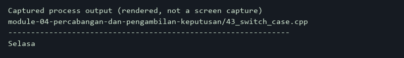

##### 44. Decision Making with Ternary Operator

- **Source Code**: [`44_ternary_decision.cpp`](./module-04-percabangan-dan-pengambilan-keputusan/44_ternary_decision.cpp)
- **Key Concept**: Expression-level decision branching.
- **Mechanism**: Assigns completion or pass/fail message strings concisely using ternary conditional expressions.
- **Execution Output**:

  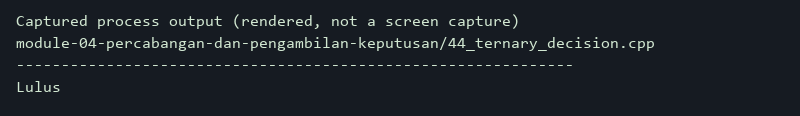

##### 45. Grade Calculator

- **Source Code**: [`45_grade_calculator.cpp`](./module-04-percabangan-dan-pengambilan-keputusan/45_grade_calculator.cpp)
- **Key Concept**: Input validation and grade classification.
- **Mechanism**: Validates input scores within the 0–100 range and maps them to academic letter grades from A through E.
- **Execution Output**:

  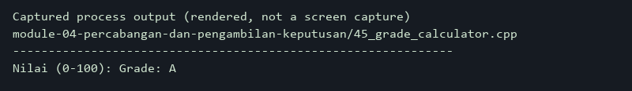

##### 46. Even and Odd Number Checker

- **Source Code**: [`46_even_odd.cpp`](./module-04-percabangan-dan-pengambilan-keputusan/46_even_odd.cpp)
- **Key Concept**: Arithmetic parity classification.
- **Mechanism**: Applies the modulo operator (% 2) to determine whether user-supplied integers are even or odd.
- **Execution Output**:

  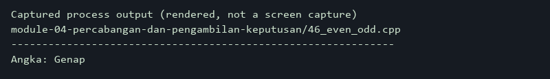

##### 47. Leap Year Checker

- **Source Code**: [`47_leap_year.cpp`](./module-04-percabangan-dan-pengambilan-keputusan/47_leap_year.cpp)
- **Key Concept**: Calendar logic with compound boolean criteria.
- **Mechanism**: Implements the Gregorian calendar rule: divisible by 400 or (divisible by 4 and not divisible by 100).
- **Execution Output**:

  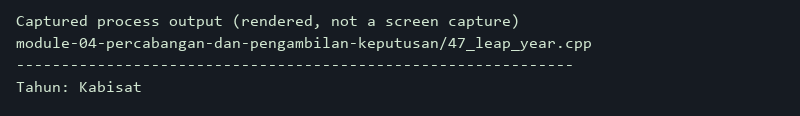

##### 48. Simple Calculator

- **Source Code**: [`48_simple_calculator.cpp`](./module-04-percabangan-dan-pengambilan-keputusan/48_simple_calculator.cpp)
- **Key Concept**: Arithmetic dispatch and error handling.
- **Mechanism**: Evaluates arithmetic operations via switch, guarding against invalid operators and division-by-zero errors.
- **Execution Output**:

  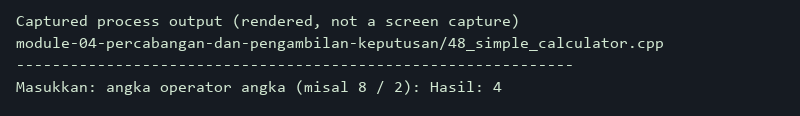

### Module 05: Loops and Iterations

**Curriculum Path**: [`module-05-perulangan`](./module-05-perulangan) | **Level**: `Fundamental` | **Scope**: 15 Programs

#### Overview & Concepts Covered

Focuses on iterative control flow using `for`, `while`, and `do-while` loops, nested loops, loop interrupts with `break` and `continue`, and algorithmic pattern and sequence generation.

#### Subtopics & Execution Captures

##### 49. For Loop

- **Source Code**: [`49_for_loop.cpp`](./module-05-perulangan/49_for_loop.cpp)
- **Key Concept**: Count-controlled iterative execution.
- **Mechanism**: Executes an indexed for loop running an integer counter from one to five.
- **Execution Output**:

  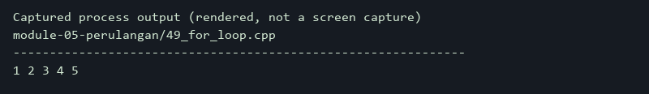

##### 50. While Loop

- **Source Code**: [`50_while_loop.cpp`](./module-05-perulangan/50_while_loop.cpp)
- **Key Concept**: Condition-controlled iterative execution.
- **Mechanism**: Repeats a code block using a while loop as long as the counter condition remains true.
- **Execution Output**:

  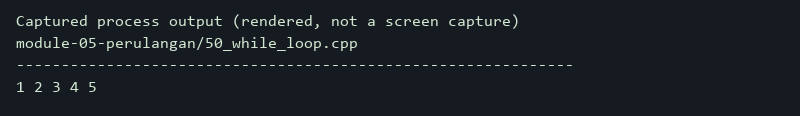

##### 51. Do-While Loop

- **Source Code**: [`51_do_while.cpp`](./module-05-perulangan/51_do_while.cpp)
- **Key Concept**: Post-condition guaranteed iteration.
- **Mechanism**: Executes loop body instructions at least once prior to evaluating the termination condition.
- **Execution Output**:

  

##### 52. Nested Loops

- **Source Code**: [`52_nested_loop.cpp`](./module-05-perulangan/52_nested_loop.cpp)
- **Key Concept**: Multi-dimensional iteration.
- **Mechanism**: Nests two for loops to generate and display a formatted 3x3 multiplication table.
- **Execution Output**:

  

##### 53. Break Statement

- **Source Code**: [`53_break_statement.cpp`](./module-05-perulangan/53_break_statement.cpp)
- **Key Concept**: Early loop termination.
- **Mechanism**: Terminates loop execution prematurely when the iteration counter reaches a specific target value.
- **Execution Output**:

  

##### 54. Continue Statement

- **Source Code**: [`54_continue_statement.cpp`](./module-05-perulangan/54_continue_statement.cpp)
- **Key Concept**: Skipping loop iterations.
- **Mechanism**: Bypasses the remainder of the current loop iteration for a specific number while continuing subsequent cycles.
- **Execution Output**:

  

##### 55. Loop Counter

- **Source Code**: [`55_loop_counter.cpp`](./module-05-perulangan/55_loop_counter.cpp)
- **Key Concept**: Filtered conditional counting.
- **Mechanism**: Iterates from 1 to 10, incrementing an accumulator counter exclusively for numbers divisible by two.
- **Execution Output**:

  

##### 56. Cumulative Summation Loop

- **Source Code**: [`56_sum_numbers.cpp`](./module-05-perulangan/56_sum_numbers.cpp)
- **Key Concept**: Iterative accumulator pattern.
- **Mechanism**: Accumulates integers iteratively from one up to a user-specified bound (0–1000).
- **Execution Output**:

  

##### 57. Factorial Loop

- **Source Code**: [`57_factorial_loop.cpp`](./module-05-perulangan/57_factorial_loop.cpp)
- **Key Concept**: Iterative product and overflow protection.
- **Mechanism**: Computes n! via repeated multiplication, utilizing unsigned long long up to n=20 to prevent overflow.
- **Execution Output**:

  

##### 58. Multiplication Table

- **Source Code**: [`58_multiplication_table.cpp`](./module-05-perulangan/58_multiplication_table.cpp)
- **Key Concept**: Sequential arithmetic table generation.
- **Mechanism**: Iterates through ten consecutive integers to output the complete multiplication table for the number five.
- **Execution Output**:

  

##### 59. Number Patterns

- **Source Code**: [`59_number_patterns.cpp`](./module-05-perulangan/59_number_patterns.cpp)
- **Key Concept**: Algorithmic numeric pyramid rendering.
- **Mechanism**: Uses nested loops where the inner loop prints numbers from 1 to the current row index, forming a triangle.
- **Execution Output**:

  

##### 60. Star Patterns

- **Source Code**: [`60_star_patterns.cpp`](./module-05-perulangan/60_star_patterns.cpp)
- **Key Concept**: Geometric asterisk grid rendering.
- **Mechanism**: Generates an ascending asterisk (*) triangle by varying inner loop repetition count based on the row index.
- **Execution Output**:

  

##### 61. Prime Number Checker

- **Source Code**: [`61_prime_number.cpp`](./module-05-perulangan/61_prime_number.cpp)
- **Key Concept**: Trial division primality testing.
- **Mechanism**: Checks divisors up to the square root of the target integer, rejecting non-primes and values below two.
- **Execution Output**:

  

##### 62. Fibonacci Sequence Loop

- **Source Code**: [`62_fibonacci_loop.cpp`](./module-05-perulangan/62_fibonacci_loop.cpp)
- **Key Concept**: State-tracking sequence generation.
- **Mechanism**: Generates the first ten Fibonacci numbers iteratively using two tracking variables to store previous terms.
- **Execution Output**:

  

##### 63. Number Guessing Game

- **Source Code**: [`63_guessing_game.cpp`](./module-05-perulangan/63_guessing_game.cpp)
- **Key Concept**: Randomized gameplay with iterative feedback.
- **Mechanism**: Generates a pseudo-random target (1–10) and provides directional feedback (higher/lower) across five attempts.
- **Execution Output**:

  

### Module 06: Functions and Scope

**Curriculum Path**: [`module-06-fungsi`](./module-06-fungsi) | **Level**: `Intermediate` | **Scope**: 15 Programs

#### Overview & Concepts Covered

Dives into modular program architecture, function prototypes, value vs. reference parameter passing semantics, const references, function overloading, recursion, lambdas, and function pointers.

#### Subtopics & Execution Captures

##### 64. Basic Functions

- **Source Code**: [`64_function_basic.cpp`](./module-06-fungsi/64_function_basic.cpp)
- **Key Concept**: Modular procedure declaration and call.
- **Mechanism**: Defines a separate greeting function and invokes it from the main() entry point.
- **Execution Output**:

  

##### 65. Function Parameters

- **Source Code**: [`65_function_parameters.cpp`](./module-06-fungsi/65_function_parameters.cpp)
- **Key Concept**: Passing data into functions.
- **Mechanism**: Defines a parameterized greeting function and invokes it with distinct string arguments.
- **Execution Output**:

  

##### 66. Function Return Values

- **Source Code**: [`66_function_return.cpp`](./module-06-fungsi/66_function_return.cpp)
- **Key Concept**: Returning computational results.
- **Mechanism**: Computes numerical addition inside a function and returns the sum directly for console output.
- **Execution Output**:

  

##### 67. Void Functions

- **Source Code**: [`67_void_function.cpp`](./module-06-fungsi/67_void_function.cpp)
- **Key Concept**: Side-effect procedures without return values.
- **Mechanism**: Draws a visual dividing line of specified length without returning a value to the caller.
- **Execution Output**:

  

##### 68. Function Prototypes

- **Source Code**: [`68_function_prototype.cpp`](./module-06-fungsi/68_function_prototype.cpp)
- **Key Concept**: Forward declaration of functions.
- **Mechanism**: Declares function signatures before main() to satisfy compiler lookups while defining implementations below.
- **Execution Output**:

  

##### 69. Default Arguments

- **Source Code**: [`69_default_arguments.cpp`](./module-06-fungsi/69_default_arguments.cpp)
- **Key Concept**: Optional parameters with fallback values.
- **Mechanism**: Specifies default argument values in function headers that are used when callers omit explicit arguments.
- **Execution Output**:

  

##### 70. Function Overloading

- **Source Code**: [`70_function_overloading.cpp`](./module-06-fungsi/70_function_overloading.cpp)
- **Key Concept**: Name polymorphism based on parameter signatures.
- **Mechanism**: Defines multiple functions sharing the same name but differentiated by parameter counts and types.
- **Execution Output**:

  

##### 71. Pass by Value

- **Source Code**: [`71_pass_by_value.cpp`](./module-06-fungsi/71_pass_by_value.cpp)
- **Key Concept**: Copy semantics and caller isolation.
- **Mechanism**: Passes arguments by value, demonstrating that parameter mutations inside the function do not affect caller variables.
- **Execution Output**:

  

##### 72. Pass by Reference

- **Source Code**: [`72_pass_by_reference.cpp`](./module-06-fungsi/72_pass_by_reference.cpp)
- **Key Concept**: Direct caller variable mutation.
- **Mechanism**: Accepts arguments by reference (int&), enabling functions to modify caller variables in place.
- **Execution Output**:

  

##### 73. Const Reference Parameters

- **Source Code**: [`73_const_reference.cpp`](./module-06-fungsi/73_const_reference.cpp)
- **Key Concept**: Efficient read-only argument passing.
- **Mechanism**: Passes large objects via const reference (const std::string&) to eliminate copy overhead while enforcing immutability.
- **Execution Output**:

  

##### 74. Recursive Functions

- **Source Code**: [`74_recursive_function.cpp`](./module-06-fungsi/74_recursive_function.cpp)
- **Key Concept**: Self-referential execution with base cases.
- **Mechanism**: Calls itself recursively with decreasing parameters until hitting the termination base case (n == 0).
- **Execution Output**:

  

##### 75. Recursive Factorial

- **Source Code**: [`75_recursive_factorial.cpp`](./module-06-fungsi/75_recursive_factorial.cpp)
- **Key Concept**: Mathematical recursion implementation.
- **Mechanism**: Implements n! recursively with base case n <= 1, multiplying n by factorial(n - 1).
- **Execution Output**:

  

##### 76. Recursive Fibonacci

- **Source Code**: [`76_recursive_fibonacci.cpp`](./module-06-fungsi/76_recursive_fibonacci.cpp)
- **Key Concept**: Branching recursive sequence computation.
- **Mechanism**: Calculates Fibonacci terms recursively with base cases for 0 and 1, producing small sequence numbers.
- **Execution Output**:

  

##### 77. Lambda Functions

- **Source Code**: [`77_lambda_function.cpp`](./module-06-fungsi/77_lambda_function.cpp)
- **Key Concept**: Anonymous inline callable objects.
- **Mechanism**: Stores an anonymous lambda expression in an auto variable and invokes it like a standard function.
- **Execution Output**:

  

##### 78. Function Pointers

- **Source Code**: [`78_function_pointer.cpp`](./module-06-fungsi/78_function_pointer.cpp)
- **Key Concept**: Passing functions as callable address pointers.
- **Mechanism**: Stores the memory address of an addition function in a function pointer and invokes it dynamically.
- **Execution Output**:

  

### Module 07: Arrays, Strings, and Data Collections

**Curriculum Path**: [`module-07-array-string-dan-koleksi-data`](./module-07-array-string-dan-koleksi-data) | **Level**: `Intermediate` | **Scope**: 19 Programs

#### Overview & Concepts Covered

Covers contiguous memory storage and text handling, including fixed-size arrays, multi-dimensional matrix operations, C-style strings, modern `std::string` manipulation, and dynamic sequences via `std::vector`.

#### Subtopics & Execution Captures

##### 79. One-Dimensional Arrays

- **Source Code**: [`79_array_basic.cpp`](./module-07-array-string-dan-koleksi-data/79_array_basic.cpp)
- **Key Concept**: Contiguous fixed-size indexable storage.
- **Mechanism**: Allocates a fixed-size integer array and accesses elements via zero-based indexing.
- **Execution Output**:

  

##### 80. Array Element Input

- **Source Code**: [`80_array_input.cpp`](./module-07-array-string-dan-koleksi-data/80_array_input.cpp)
- **Key Concept**: Sequential user input into arrays.
- **Mechanism**: Populates array slots sequentially from user input via loops, followed by secondary loop verification printing.
- **Execution Output**:

  

##### 81. Array Iteration

- **Source Code**: [`81_array_iteration.cpp`](./module-07-array-string-dan-koleksi-data/81_array_iteration.cpp)
- **Key Concept**: Modern range-based for loop traversal.
- **Mechanism**: Traverses all elements of a raw array sequentially using a modern range-based for loop.
- **Execution Output**:

  

##### 82. Array Sum and Average

- **Source Code**: [`82_array_sum_average.cpp`](./module-07-array-string-dan-koleksi-data/82_array_sum_average.cpp)
- **Key Concept**: Iterative reduction and floating-point casting.
- **Mechanism**: Accumulates elements in an array and casts the sum to double to calculate an accurate floating-point mean.
- **Execution Output**:

  

##### 83. Array Minimum and Maximum Values

- **Source Code**: [`83_array_min_max.cpp`](./module-07-array-string-dan-koleksi-data/83_array_min_max.cpp)
- **Key Concept**: Extremum tracking algorithms.
- **Mechanism**: Iterates through an array, updating running minimum and maximum values via comparative checks.
- **Execution Output**:

  

##### 84. Linear Array Search

- **Source Code**: [`84_array_search.cpp`](./module-07-array-string-dan-koleksi-data/84_array_search.cpp)
- **Key Concept**: Sequential target lookup.
- **Mechanism**: Scans array elements sequentially, returning the first matching index or -1 if the target is absent.
- **Execution Output**:

  

##### 85. Array Sorting

- **Source Code**: [`85_array_sorting.cpp`](./module-07-array-string-dan-koleksi-data/85_array_sorting.cpp)
- **Key Concept**: In-place range sorting with std::sort.
- **Mechanism**: Applies std::sort to an array range and prints the sorted results sequentially.
- **Execution Output**:

  

##### 86. Multidimensional Arrays

- **Source Code**: [`86_multidimensional_array.cpp`](./module-07-array-string-dan-koleksi-data/86_multidimensional_array.cpp)
- **Key Concept**: Two-dimensional matrix allocation.
- **Mechanism**: Initializes a 2D matrix of rows and columns, traversing and displaying elements via nested loops.
- **Execution Output**:

  

##### 87. Matrix Addition

- **Source Code**: [`87_matrix_addition.cpp`](./module-07-array-string-dan-koleksi-data/87_matrix_addition.cpp)
- **Key Concept**: Element-wise matrix summation.
- **Mechanism**: Computes the sum of two matrices by adding corresponding row and column cells into a result matrix.
- **Execution Output**:

  

##### 88. Matrix Multiplication

- **Source Code**: [`88_matrix_multiplication.cpp`](./module-07-array-string-dan-koleksi-data/88_matrix_multiplication.cpp)
- **Key Concept**: Row-by-column matrix product calculation.
- **Mechanism**: Implements triple nested loops to compute dot products of row vectors and column vectors.
- **Execution Output**:

  

##### 89. String Operations

- **Source Code**: [`89_string_operations.cpp`](./module-07-array-string-dan-koleksi-data/89_string_operations.cpp)
- **Key Concept**: String concatenation and size inspection.
- **Mechanism**: Concatenates strings using the + operator and measures combined character lengths via size().
- **Execution Output**:

  

##### 90. std::string Member Methods

- **Source Code**: [`90_string_methods.cpp`](./module-07-array-string-dan-koleksi-data/90_string_methods.cpp)
- **Key Concept**: Substring extraction and text replacement.
- **Mechanism**: Extracts prefix substrings using substr() and modifies portions of string content via replace().
- **Execution Output**:

  

##### 91. Text Substring Search

- **Source Code**: [`91_string_search.cpp`](./module-07-array-string-dan-koleksi-data/91_string_search.cpp)
- **Key Concept**: Substring lookup and std::string::npos.
- **Mechanism**: Searches for target substrings using find() and validates presence against std::string::npos.
- **Execution Output**:

  

##### 92. String Manipulation

- **Source Code**: [`92_string_manipulation.cpp`](./module-07-array-string-dan-koleksi-data/92_string_manipulation.cpp)
- **Key Concept**: Character-level transformation.
- **Mechanism**: Applies std::toupper to string characters, casting safely through unsigned char to satisfy standard requirements.
- **Execution Output**:

  

##### 93. C-Style Strings

- **Source Code**: [`93_c_style_string.cpp`](./module-07-array-string-dan-koleksi-data/93_c_style_string.cpp)
- **Key Concept**: Null-terminated character arrays.
- **Mechanism**: Inspects null-terminated char arrays and computes string length up to the terminator using std::strlen.
- **Execution Output**:

  

##### 94. Vector Basics (std::vector)

- **Source Code**: [`94_vector_basic.cpp`](./module-07-array-string-dan-koleksi-data/94_vector_basic.cpp)
- **Key Concept**: Dynamic heap-allocated contiguous sequences.
- **Mechanism**: Instantiates std::vector to store integers in a dynamically resizable array container.
- **Execution Output**:

  

##### 95. Vector Operations

- **Source Code**: [`95_vector_operations.cpp`](./module-07-array-string-dan-koleksi-data/95_vector_operations.cpp)
- **Key Concept**: Vector mutation and state queries.
- **Mechanism**: Demonstrates push_back, erase from front, size queries, and back element access.
- **Execution Output**:

  

##### 96. Vector Sorting

- **Source Code**: [`96_vector_sorting.cpp`](./module-07-array-string-dan-koleksi-data/96_vector_sorting.cpp)
- **Key Concept**: Sorting vector ranges via iterators.
- **Mechanism**: Sorts a dynamic vector using std::sort with begin() and end() iterator pairs.
- **Execution Output**:

  

##### 97. Vector of Custom Objects

- **Source Code**: [`97_vector_of_objects.cpp`](./module-07-array-string-dan-koleksi-data/97_vector_of_objects.cpp)
- **Key Concept**: Collection of structured record instances.
- **Mechanism**: Stores custom student struct instances in a vector and iterates through their member fields.
- **Execution Output**:

  

### Module 08: Pointers and Memory Management

**Curriculum Path**: [`module-08-pointer-dan-pengelolaan-memori`](./module-08-pointer-dan-pengelolaan-memori) | **Level**: `Intermediate to Advanced` | **Scope**: 15 Programs

#### Overview & Concepts Covered

Examines low-level memory addressing, pointer arithmetic, manual heap management (`new`/`delete`), references vs. pointers, RAII idioms, and modern smart pointers (`std::unique_ptr`, `std::shared_ptr`, `std::weak_ptr`).

#### Subtopics & Execution Captures

##### 98. Memory Addresses

- **Source Code**: [`98_memory_address.cpp`](./module-08-pointer-dan-pengelolaan-memori/98_memory_address.cpp)
- **Key Concept**: The address-of operator (&).
- **Mechanism**: Queries and prints hardware memory addresses of stack variables using the unary & operator.
- **Execution Output**:

  

##### 99. Pointer Basics

- **Source Code**: [`99_pointer_basic.cpp`](./module-08-pointer-dan-pengelolaan-memori/99_pointer_basic.cpp)
- **Key Concept**: Pointer variables and address storage.
- **Mechanism**: Stores variable addresses in typed pointers (int*) and reads target values via the * dereference operator.
- **Execution Output**:

  

##### 100. Pointer Dereferencing

- **Source Code**: [`100_pointer_dereference.cpp`](./module-08-pointer-dan-pengelolaan-memori/100_pointer_dereference.cpp)
- **Key Concept**: Mutating pointed-to memory values.
- **Mechanism**: Modifies the underlying integer variable by writing values through a dereferenced pointer (*ptr).
- **Execution Output**:

  

##### 101. Pointers and Arrays

- **Source Code**: [`101_pointer_and_array.cpp`](./module-08-pointer-dan-pengelolaan-memori/101_pointer_and_array.cpp)
- **Key Concept**: Array decay and pointer indexing.
- **Mechanism**: Demonstrates how raw array identifiers decay into pointers to their first elements and offsets read subsequent elements.
- **Execution Output**:

  

##### 102. Pointer Arithmetic

- **Source Code**: [`102_pointer_arithmetic.cpp`](./module-08-pointer-dan-pengelolaan-memori/102_pointer_arithmetic.cpp)
- **Key Concept**: Type-scaled memory address advancement.
- **Mechanism**: Increments pointers with ++, illustrating that memory advancement scales by sizeof(type) bytes.
- **Execution Output**:

  

##### 103. Null Pointer (nullptr)

- **Source Code**: [`103_nullptr.cpp`](./module-08-pointer-dan-pengelolaan-memori/103_nullptr.cpp)
- **Key Concept**: Safe pointer initialization and null checking.
- **Mechanism**: Initializes empty pointers with nullptr and validates pointer validity prior to dereferencing.
- **Execution Output**:

  

##### 104. Pointers as Function Parameters

- **Source Code**: [`104_pointer_function.cpp`](./module-08-pointer-dan-pengelolaan-memori/104_pointer_function.cpp)
- **Key Concept**: Passing pointers for caller mutation.
- **Mechanism**: Accepts pointer parameters, checks for null safety, and modifies caller variables through dereferencing.
- **Execution Output**:

  

##### 105. References vs. Pointers

- **Source Code**: [`105_reference_vs_pointer.cpp`](./module-08-pointer-dan-pengelolaan-memori/105_reference_vs_pointer.cpp)
- **Key Concept**: Comparative analysis of aliases and pointers.
- **Mechanism**: Binds both a reference and a pointer to the same variable, showing syntax and mutation differences.
- **Execution Output**:

  

##### 106. Dynamic Memory Allocation with new

- **Source Code**: [`106_dynamic_memory_new.cpp`](./module-08-pointer-dan-pengelolaan-memori/106_dynamic_memory_new.cpp)
- **Key Concept**: Heap memory acquisition and release.
- **Mechanism**: Allocates heap memory dynamically using new int and releases it safely using delete.
- **Execution Output**:

  

##### 107. Memory Deallocation with delete

- **Source Code**: [`107_dynamic_memory_delete.cpp`](./module-08-pointer-dan-pengelolaan-memori/107_dynamic_memory_delete.cpp)
- **Key Concept**: Dangling pointer prevention.
- **Mechanism**: Releases allocated heap memory with delete and resets pointers to nullptr to eliminate dangling pointers.
- **Execution Output**:

  

##### 108. Dynamic Arrays

- **Source Code**: [`108_dynamic_array.cpp`](./module-08-pointer-dan-pengelolaan-memori/108_dynamic_array.cpp)
- **Key Concept**: Heap array allocation and array delete.
- **Mechanism**: Allocates dynamic arrays using new int[n] and deallocates contiguous blocks using delete[].
- **Execution Output**:

  

##### 109. Smart Pointers: unique_ptr

- **Source Code**: [`109_unique_ptr.cpp`](./module-08-pointer-dan-pengelolaan-memori/109_unique_ptr.cpp)
- **Key Concept**: Exclusive ownership with automatic destruction.
- **Mechanism**: Creates exclusive-ownership smart pointers with std::make_unique that deallocate heap memory automatically via RAII.
- **Execution Output**:

  

##### 110. Smart Pointers: shared_ptr

- **Source Code**: [`110_shared_ptr.cpp`](./module-08-pointer-dan-pengelolaan-memori/110_shared_ptr.cpp)
- **Key Concept**: Reference-counted shared ownership.
- **Mechanism**: Shares heap ownership across multiple std::shared_ptr instances, tracking live owners via use_count().
- **Execution Output**:

  

##### 111. Smart Pointers: weak_ptr

- **Source Code**: [`111_weak_ptr.cpp`](./module-08-pointer-dan-pengelolaan-memori/111_weak_ptr.cpp)
- **Key Concept**: Non-owning references preventing cyclic leaks.
- **Mechanism**: Observes shared_ptr objects with std::weak_ptr without incrementing reference counts, locking safely when active.
- **Execution Output**:

  

##### 112. Resource Acquisition Is Initialization (RAII)

- **Source Code**: [`112_raii.cpp`](./module-08-pointer-dan-pengelolaan-memori/112_raii.cpp)
- **Key Concept**: Deterministic resource cleanup via destructors.
- **Mechanism**: Encapsulates resource acquisition in constructors and deterministic cleanup in destructors upon leaving scope.
- **Execution Output**:

  

### Module 09: User-Defined Data Structures

**Curriculum Path**: [`module-09-struktur-data-buatan-pengguna`](./module-09-struktur-data-buatan-pengguna) | **Level**: `Intermediate` | **Scope**: 9 Programs

#### Overview & Concepts Covered

Covers custom composite data types, including C++ structures (`struct`), arrays of structs, unscoped and scoped enumerations (`enum class`), type aliases (`using`), memory-overlapping `union`, and record models.

#### Subtopics & Execution Captures

##### 113. Structure Basics (struct)

- **Source Code**: [`113_struct_basic.cpp`](./module-09-struktur-data-buatan-pengguna/113_struct_basic.cpp)
- **Key Concept**: Grouping related heterogeneous data fields.
- **Mechanism**: Defines a custom Student struct grouping name and age into a cohesive aggregate entity.
- **Execution Output**:

  

##### 114. Array of Structures

- **Source Code**: [`114_struct_array.cpp`](./module-09-struktur-data-buatan-pengguna/114_struct_array.cpp)
- **Key Concept**: Sequential storage of composite records.
- **Mechanism**: Creates an array of struct instances and iterates through each record's member fields.
- **Execution Output**:

  

##### 115. Structures as Function Parameters

- **Source Code**: [`115_struct_function.cpp`](./module-09-struktur-data-buatan-pengguna/115_struct_function.cpp)
- **Key Concept**: Passing structs by const reference.
- **Mechanism**: Passes struct instances to functions via const reference to eliminate copying overhead.
- **Execution Output**:

  

##### 116. Enumerations (enum)

- **Source Code**: [`116_enum_basic.cpp`](./module-09-struktur-data-buatan-pengguna/116_enum_basic.cpp)
- **Key Concept**: Named integral symbolic constants.
- **Mechanism**: Defines traditional C-style enumerations to assign readable names to integer day values.
- **Execution Output**:

  

##### 117. Scoped Enumerations (enum class)

- **Source Code**: [`117_enum_class.cpp`](./module-09-struktur-data-buatan-pengguna/117_enum_class.cpp)
- **Key Concept**: Strongly-typed scoped enumerators.
- **Mechanism**: Defines scoped enum class types to eliminate name collisions and prevent implicit integer conversions.
- **Execution Output**:

  

##### 118. Type Aliasing with using

- **Source Code**: [`118_typedef_using.cpp`](./module-09-struktur-data-buatan-pengguna/118_typedef_using.cpp)
- **Key Concept**: Readable type aliases for complex types.
- **Mechanism**: Creates clean type aliases for std::vector<int> using the modern using keyword.
- **Execution Output**:

  

##### 119. Unions

- **Source Code**: [`119_union_basic.cpp`](./module-09-struktur-data-buatan-pengguna/119_union_basic.cpp)
- **Key Concept**: Memory-overlapping mutually exclusive fields.
- **Mechanism**: Defines a union sharing a single memory location across members, reading only the most recently written field.
- **Execution Output**:

  

##### 120. Nested Structures

- **Source Code**: [`120_nested_struct.cpp`](./module-09-struktur-data-buatan-pengguna/120_nested_struct.cpp)
- **Key Concept**: Hierarchical composite data types.
- **Mechanism**: Nests an Address struct within a Student struct, accessing hierarchical fields via chained dot operators.
- **Execution Output**:

  

##### 121. Simple Data Record System

- **Source Code**: [`121_data_record.cpp`](./module-09-struktur-data-buatan-pengguna/121_data_record.cpp)
- **Key Concept**: In-memory database using struct vectors.
- **Mechanism**: Implements an in-memory student record manager using struct vectors to store and display student IDs, names, and scores.
- **Execution Output**:

  

### Module 10: Object-Oriented Programming (OOP)

**Curriculum Path**: [`module-10-object-oriented-programming-oop`](./module-10-object-oriented-programming-oop) | **Level**: `Intermediate to Advanced` | **Scope**: 26 Programs

#### Overview & Concepts Covered

Provides comprehensive coverage of object-oriented principles: encapsulation, constructors/destructors, member initializer lists, the `this` pointer, static members, operator overloading, inheritance hierarchies, runtime polymorphism, virtual functions, and abstract interfaces.

#### Subtopics & Execution Captures

##### 122. Classes and Objects

- **Source Code**: [`122_class_basic.cpp`](./module-10-object-oriented-programming-oop/122_class_basic.cpp)
- **Key Concept**: Object instantiation and member method dispatch.
- **Mechanism**: Instantiates an object from a Lamp class and invokes its public member methods.
- **Execution Output**:

  

##### 123. Data Members and Member Functions

- **Source Code**: [`123_class_members.cpp`](./module-10-object-oriented-programming-oop/123_class_members.cpp)
- **Key Concept**: Internal state encapsulation and methods.
- **Mechanism**: Encapsulates private side-length dimensions and provides public methods to compute geometric area.
- **Execution Output**:

  

##### 124. Access Specifiers (public, private, protected)

- **Source Code**: [`124_access_specifiers.cpp`](./module-10-object-oriented-programming-oop/124_access_specifiers.cpp)
- **Key Concept**: Access boundary enforcement.
- **Mechanism**: Enforces data hiding: private members are restricted to the class, protected to descendants, and public accessible externally.
- **Execution Output**:

  

##### 125. Constructors

- **Source Code**: [`125_constructor.cpp`](./module-10-object-oriented-programming-oop/125_constructor.cpp)
- **Key Concept**: Object state initialization.
- **Mechanism**: Defines parameterized constructors that initialize object fields upon instantiation.
- **Execution Output**:

  

##### 126. Constructor Overloading

- **Source Code**: [`126_constructor_overloading.cpp`](./module-10-object-oriented-programming-oop/126_constructor_overloading.cpp)
- **Key Concept**: Multiple constructor signatures.
- **Mechanism**: Provides multiple constructor overloads supporting default parameters and explicit dimensional initialization.
- **Execution Output**:

  

##### 127. Destructors

- **Source Code**: [`127_destructor.cpp`](./module-10-object-oriented-programming-oop/127_destructor.cpp)
- **Key Concept**: Automated cleanup upon object lifetime expiration.
- **Mechanism**: Executes class destructors automatically to perform cleanup logging when objects go out of scope.
- **Execution Output**:

  

##### 128. Member Initializer Lists

- **Source Code**: [`128_initializer_list.cpp`](./module-10-object-oriented-programming-oop/128_initializer_list.cpp)
- **Key Concept**: Direct initialization of const and member data.
- **Mechanism**: Initializes const fields and member variables before constructor body execution using initializer lists.
- **Execution Output**:

  

##### 129. Encapsulation

- **Source Code**: [`129_encapsulation.cpp`](./module-10-object-oriented-programming-oop/129_encapsulation.cpp)
- **Key Concept**: State protection and invariant enforcement.
- **Mechanism**: Protects private bank account balances, allowing mutations strictly through deposit methods that reject invalid values.
- **Execution Output**:

  

##### 130. Getters and Setters

- **Source Code**: [`130_getter_setter.cpp`](./module-10-object-oriented-programming-oop/130_getter_setter.cpp)
- **Key Concept**: Controlled member access and validation.
- **Mechanism**: Validates incoming data (0–100) inside setters before assignment and exposes values safely through getters.
- **Execution Output**:

  

##### 131. The this Pointer

- **Source Code**: [`131_this_pointer.cpp`](./module-10-object-oriented-programming-oop/131_this_pointer.cpp)
- **Key Concept**: Self-referencing pointer and method chaining.
- **Mechanism**: Uses the this pointer to resolve parameter shadowing and returns *this to enable fluent method chaining.
- **Execution Output**:

  

##### 132. Static Class Members

- **Source Code**: [`132_static_members.cpp`](./module-10-object-oriented-programming-oop/132_static_members.cpp)
- **Key Concept**: Shared class-level state.
- **Mechanism**: Maintains a static instance counter shared across all class objects, incremented and decremented in constructors/destructors.
- **Execution Output**:

  

##### 133. Static Member Functions

- **Source Code**: [`133_static_functions.cpp`](./module-10-object-oriented-programming-oop/133_static_functions.cpp)
- **Key Concept**: Class-scoped functions without object context.
- **Mechanism**: Defines static member functions that can be invoked directly from the class name without object instances.
- **Execution Output**:

  

##### 134. Friend Functions

- **Source Code**: [`134_friend_function.cpp`](./module-10-object-oriented-programming-oop/134_friend_function.cpp)
- **Key Concept**: Granting external functions private access.
- **Mechanism**: Declares external friend functions permitted to inspect private member variables directly.
- **Execution Output**:

  

##### 135. Operator Overloading

- **Source Code**: [`135_operator_overloading.cpp`](./module-10-object-oriented-programming-oop/135_operator_overloading.cpp)
- **Key Concept**: Custom operators for user-defined types.
- **Mechanism**: Overloads operator+ to provide intuitive vector-style addition between Point coordinate objects.
- **Execution Output**:

  

##### 136. Basic Inheritance

- **Source Code**: [`136_inheritance_basic.cpp`](./module-10-object-oriented-programming-oop/136_inheritance_basic.cpp)
- **Key Concept**: Deriving subclasses and code reuse.
- **Mechanism**: Derives a Cat class from an Animal base class, inheriting base behaviors while introducing specific methods.
- **Execution Output**:

  

##### 137. Multilevel Inheritance

- **Source Code**: [`137_multilevel_inheritance.cpp`](./module-10-object-oriented-programming-oop/137_multilevel_inheritance.cpp)
- **Key Concept**: Multi-tier inheritance chains.
- **Mechanism**: Demonstrates multi-tiered inheritance where a derived class inherits through an intermediate Mammal layer.
- **Execution Output**:

  

##### 138. Multiple Inheritance

- **Source Code**: [`138_multiple_inheritance.cpp`](./module-10-object-oriented-programming-oop/138_multiple_inheritance.cpp)
- **Key Concept**: Inheriting behaviors from multiple base classes.
- **Mechanism**: Creates a multi-functional class inheriting independent capabilities from two separate parent classes.
- **Execution Output**:

  

##### 139. Virtual Functions

- **Source Code**: [`139_virtual_function.cpp`](./module-10-object-oriented-programming-oop/139_virtual_function.cpp)
- **Key Concept**: Dynamic dispatch and polymorphic method binding.
- **Mechanism**: Enables dynamic method dispatch via virtual functions, executing derived overrides through base class references.
- **Execution Output**:

  

##### 140. Function Overriding

- **Source Code**: [`140_function_overriding.cpp`](./module-10-object-oriented-programming-oop/140_function_overriding.cpp)
- **Key Concept**: Explicit derived method overriding.
- **Mechanism**: Applies the override keyword to ensure derived method signatures match virtual base signatures exactly.
- **Execution Output**:

  

##### 141. Polymorphism

- **Source Code**: [`141_polymorphism.cpp`](./module-10-object-oriented-programming-oop/141_polymorphism.cpp)
- **Key Concept**: Uniform interface for heterogeneous objects.
- **Mechanism**: Iterates through an array of base class pointers, dispatching specialized area calculations polymorphically.
- **Execution Output**:

  

##### 142. Abstract Classes

- **Source Code**: [`142_abstract_class.cpp`](./module-10-object-oriented-programming-oop/142_abstract_class.cpp)
- **Key Concept**: Incomplete base classes defining contracts.
- **Mechanism**: Defines an abstract base class with pure virtual methods that cannot be directly instantiated.
- **Execution Output**:

  

##### 143. Pure Virtual Functions

- **Source Code**: [`143_pure_virtual_function.cpp`](./module-10-object-oriented-programming-oop/143_pure_virtual_function.cpp)
- **Key Concept**: Mandatory interface implementation contracts.
- **Mechanism**: Enforces that derived classes must implement pure virtual methods (= 0) before instantiation.
- **Execution Output**:

  

##### 144. Virtual Destructors

- **Source Code**: [`144_virtual_destructor.cpp`](./module-10-object-oriented-programming-oop/144_virtual_destructor.cpp)
- **Key Concept**: Safe polymorphic deletion via base pointers.
- **Mechanism**: Declares virtual destructors in base classes, ensuring derived destructors execute when deleting via unique_ptr<Base>.
- **Execution Output**:

  

##### 145. Object Composition

- **Source Code**: [`145_composition.cpp`](./module-10-object-oriented-programming-oop/145_composition.cpp)
- **Key Concept**: Has-a relationship with unified lifetime.
- **Mechanism**: Composes an Engine directly inside a Car, ensuring components share concurrent lifetimes.
- **Execution Output**:

  

##### 146. Aggregation

- **Source Code**: [`146_aggregation.cpp`](./module-10-object-oriented-programming-oop/146_aggregation.cpp)
- **Key Concept**: Weak has-a relationship with independent lifetimes.
- **Mechanism**: Stores external references to a Teacher within a Classroom, where the teacher exists independently.
- **Execution Output**:

  

##### 147. Interface Design with Abstract Classes

- **Source Code**: [`147_interface_design.cpp`](./module-10-object-oriented-programming-oop/147_interface_design.cpp)
- **Key Concept**: Decoupling interfaces from implementations.
- **Mechanism**: Decouples storage functionality through an abstract Storage interface implemented by concrete classes.
- **Execution Output**:

  

### Module 11: Standard Template Library (STL)

**Curriculum Path**: [`module-11-standard-template-library-stl`](./module-11-standard-template-library-stl) | **Level**: `Intermediate to Advanced` | **Scope**: 23 Programs

#### Overview & Concepts Covered

Explores the C++ Standard Template Library, covering sequence containers (`vector`, `list`, `deque`), container adapters (`stack`, `queue`, `priority_queue`), associative containers (`set`, `multiset`, `map`, `multimap`, `unordered_map`), iterators, and generic STL algorithms.

#### Subtopics & Execution Captures

##### 148. std::pair

- **Source Code**: [`148_pair.cpp`](./module-11-standard-template-library-stl/148_pair.cpp)
- **Key Concept**: Two-element heterogeneous container.
- **Mechanism**: Pairs an ID and a name into a single entity accessible via first and second members.
- **Execution Output**:

  

##### 149. std::tuple

- **Source Code**: [`149_tuple.cpp`](./module-11-standard-template-library-stl/149_tuple.cpp)
- **Key Concept**: Fixed-size heterogeneous value collection.
- **Mechanism**: Stores three values of different types in a tuple, extracting elements via compile-time std::get<index>.
- **Execution Output**:

  

##### 150. Advanced Vector Operations

- **Source Code**: [`150_vector_advanced.cpp`](./module-11-standard-template-library-stl/150_vector_advanced.cpp)
- **Key Concept**: Memory reservation and in-place emplacement.
- **Mechanism**: Demonstrates capacity preallocation with reserve, middle insertion, and in-place construction with emplace_back.
- **Execution Output**:

  

##### 151. std::list

- **Source Code**: [`151_list.cpp`](./module-11-standard-template-library-stl/151_list.cpp)
- **Key Concept**: Doubly-linked list container.
- **Mechanism**: Utilizes std::list for efficient constant-time insertions from front (push_front) and back.
- **Execution Output**:

  

##### 152. std::deque

- **Source Code**: [`152_deque.cpp`](./module-11-standard-template-library-stl/152_deque.cpp)
- **Key Concept**: Double-ended queue container.
- **Mechanism**: Demonstrates fast insertion and deletion at both ends using std::deque.
- **Execution Output**:

  

##### 153. std::stack

- **Source Code**: [`153_stack.cpp`](./module-11-standard-template-library-stl/153_stack.cpp)
- **Key Concept**: LIFO container adapter.
- **Mechanism**: Enforces Last-In-First-Out access semantics using push, pop, and top.
- **Execution Output**:

  

##### 154. std::queue

- **Source Code**: [`154_queue.cpp`](./module-11-standard-template-library-stl/154_queue.cpp)
- **Key Concept**: FIFO container adapter.
- **Mechanism**: Enforces First-In-First-Out access semantics using push, pop, and front.
- **Execution Output**:

  

##### 155. std::priority_queue

- **Source Code**: [`155_priority_queue.cpp`](./module-11-standard-template-library-stl/155_priority_queue.cpp)
- **Key Concept**: Max-heap sorted container adapter.
- **Mechanism**: Maintains elements in a max-heap structure, extracting the largest elements first.
- **Execution Output**:

  

##### 156. std::set

- **Source Code**: [`156_set.cpp`](./module-11-standard-template-library-stl/156_set.cpp)
- **Key Concept**: Unique sorted associative container.
- **Mechanism**: Maintains elements in ascending order and automatically rejects duplicate insertions.
- **Execution Output**:

  

##### 157. std::multiset

- **Source Code**: [`157_multiset.cpp`](./module-11-standard-template-library-stl/157_multiset.cpp)
- **Key Concept**: Sorted associative container permitting duplicates.
- **Mechanism**: Stores sorted values allowing duplicates and queries element counts via count().
- **Execution Output**:

  

##### 158. std::map

- **Source Code**: [`158_map.cpp`](./module-11-standard-template-library-stl/158_map.cpp)
- **Key Concept**: Ordered key-value associative mapping.
- **Mechanism**: Maps unique string keys to values, maintaining alphabetical key ordering during traversal.
- **Execution Output**:

  

##### 159. std::multimap

- **Source Code**: [`159_multimap.cpp`](./module-11-standard-template-library-stl/159_multimap.cpp)
- **Key Concept**: Associative container with duplicate keys.
- **Mechanism**: Stores multiple values mapped under identical keys in a sorted associative container.
- **Execution Output**:

  

##### 160. std::unordered_set

- **Source Code**: [`160_unordered_set.cpp`](./module-11-standard-template-library-stl/160_unordered_set.cpp)
- **Key Concept**: Hash-based unique set.
- **Mechanism**: Stores unique keys in a hash table with average constant-time lookups using contains().
- **Execution Output**:

  

##### 161. std::unordered_map

- **Source Code**: [`161_unordered_map.cpp`](./module-11-standard-template-library-stl/161_unordered_map.cpp)
- **Key Concept**: Hash-based key-value associative container.
- **Mechanism**: Stores key-value mappings in a hash table with average O(1) retrieval without guaranteed order.
- **Execution Output**:

  

##### 162. Iterators

- **Source Code**: [`162_iterators.cpp`](./module-11-standard-template-library-stl/162_iterators.cpp)
- **Key Concept**: Standard pointer-like container traversal.
- **Mechanism**: Navigates containers using begin() and end() iterators, dereferencing elements with *it.
- **Execution Output**:

  

##### 163. Range-Based For Loops

- **Source Code**: [`163_range_based_for.cpp`](./module-11-standard-template-library-stl/163_range_based_for.cpp)
- **Key Concept**: Reference-based container mutations.
- **Mechanism**: Mutates vector elements in place using range-based for loops with references (auto&).
- **Execution Output**:

  

##### 164. std::sort Algorithm

- **Source Code**: [`164_stl_sort.cpp`](./module-11-standard-template-library-stl/164_stl_sort.cpp)
- **Key Concept**: Efficient $O(n \log n)$ sequence sorting.
- **Mechanism**: Sorts vector elements using std::sort bounded by begin and end iterator pairs.
- **Execution Output**:

  

##### 165. std::find Algorithm

- **Source Code**: [`165_stl_find.cpp`](./module-11-standard-template-library-stl/165_stl_find.cpp)
- **Key Concept**: Linear lookup in iterator ranges.
- **Mechanism**: Searches for elements in iterator ranges with std::find, computing indices using std::distance.
- **Execution Output**:

  

##### 166. std::count Algorithm

- **Source Code**: [`166_stl_count.cpp`](./module-11-standard-template-library-stl/166_stl_count.cpp)
- **Key Concept**: Counting occurrences matching criteria.
- **Mechanism**: Counts occurrences of specific target elements within container ranges.
- **Execution Output**:

  

##### 167. std::transform Algorithm

- **Source Code**: [`167_stl_transform.cpp`](./module-11-standard-template-library-stl/167_stl_transform.cpp)
- **Key Concept**: Element transformation pipelines.
- **Mechanism**: Applies a squaring lambda transformation to all elements of a range with std::transform.
- **Execution Output**:

  

##### 168. std::accumulate Algorithm

- **Source Code**: [`168_stl_accumulate.cpp`](./module-11-standard-template-library-stl/168_stl_accumulate.cpp)
- **Key Concept**: Numeric range reductions.
- **Mechanism**: Reduces a container range into a single cumulative sum with std::accumulate starting from an initial zero.
- **Execution Output**:

  

##### 169. std::remove_if Algorithm

- **Source Code**: [`169_stl_remove_if.cpp`](./module-11-standard-template-library-stl/169_stl_remove_if.cpp)
- **Key Concept**: The erase-remove idiom.
- **Mechanism**: Shifts matching elements to the end with std::remove_if and removes them via vector::erase.
- **Execution Output**:

  

##### 170. Lambdas with STL Algorithms

- **Source Code**: [`170_stl_lambda.cpp`](./module-11-standard-template-library-stl/170_stl_lambda.cpp)
- **Key Concept**: State-capturing lambdas with algorithms.
- **Mechanism**: Applies std::count_if with a lambda capturing external threshold parameters by value.
- **Execution Output**:

  

### Module 12: Templates and Generic Programming

**Curriculum Path**: [`module-12-template-dan-pemrograman-generik`](./module-12-template-dan-pemrograman-generik) | **Level**: `Advanced` | **Scope**: 9 Programs

#### Overview & Concepts Covered

Covers compile-time polymorphism and generic software design: function templates, class templates, full/partial specialization, template type deduction, variadic templates, and C++20 concepts.

#### Subtopics & Execution Captures

##### 171. Function Templates

- **Source Code**: [`171_function_template.cpp`](./module-12-template-dan-pemrograman-generik/171_function_template.cpp)
- **Key Concept**: Generic function implementations.
- **Mechanism**: Defines a generic function template selecting maximum values across int and double instantiations.
- **Execution Output**:

  

##### 172. Multiple Template Parameters

- **Source Code**: [`172_multiple_template_parameters.cpp`](./module-12-template-dan-pemrograman-generik/172_multiple_template_parameters.cpp)
- **Key Concept**: Heterogeneous type parameter templates.
- **Mechanism**: Accepts distinct types for labels and values within a single generic function template.
- **Execution Output**:

  

##### 173. Class Templates

- **Source Code**: [`173_class_template.cpp`](./module-12-template-dan-pemrograman-generik/173_class_template.cpp)
- **Key Concept**: Generic container classes.
- **Mechanism**: Implements a generic Box<T> class template holding values of specified types.
- **Execution Output**:

  

##### 174. Template Specialization

- **Source Code**: [`174_template_specialization.cpp`](./module-12-template-dan-pemrograman-generik/174_template_specialization.cpp)
- **Key Concept**: Custom behavior for specific template types.
- **Mechanism**: Specializes a class template specifically for bool to render custom output representations.
- **Execution Output**:

  

##### 175. Default Template Parameters

- **Source Code**: [`175_template_default_parameter.cpp`](./module-12-template-dan-pemrograman-generik/175_template_default_parameter.cpp)
- **Key Concept**: Fallback template type specifications.
- **Mechanism**: Provides a default type (int) for template parameters when callers omit explicit types.
- **Execution Output**:

  

##### 176. Template Type Deduction

- **Source Code**: [`176_template_type_deduction.cpp`](./module-12-template-dan-pemrograman-generik/176_template_type_deduction.cpp)
- **Key Concept**: Automatic template argument deduction (CTAD).
- **Mechanism**: Deduces template types automatically from function arguments without explicit angle brackets.
- **Execution Output**:

  

##### 177. Variadic Templates

- **Source Code**: [`177_variadic_template.cpp`](./module-12-template-dan-pemrograman-generik/177_variadic_template.cpp)
- **Key Concept**: Variable-length parameter packs and fold expressions.
- **Mechanism**: Prints arbitrary numbers of arguments using variadic parameter packs and C++17 fold expressions.
- **Execution Output**:

  

##### 178. Generic Programming

- **Source Code**: [`178_generic_programming.cpp`](./module-12-template-dan-pemrograman-generik/178_generic_programming.cpp)
- **Key Concept**: Iterator-driven generalized algorithms.
- **Mechanism**: Implements a generic summation algorithm operating identically over both std::vector and std::list.
- **Execution Output**:

  

##### 179. C++20 Concepts Introduction

- **Source Code**: [`179_concepts_intro.cpp`](./module-12-template-dan-pemrograman-generik/179_concepts_intro.cpp)
- **Key Concept**: Compile-time template type constraints.
- **Mechanism**: Constrains template types using the std::integral concept, rejecting non-integer types at compile time.
- **Execution Output**:

  

### Module 13: File Handling and Exception Handling

**Curriculum Path**: [`module-13-file-handling-dan-exception-handling`](./module-13-file-handling-dan-exception-handling) | **Level**: `Intermediate to Advanced` | **Scope**: 12 Programs

#### Overview & Concepts Covered

Covers persistent stream I/O and fault-tolerant software engineering: reading, writing, and appending files using `<fstream>`, parsing CSV files, exception handling with `try`/`catch`/`throw`, and custom exception classes.

#### Subtopics & Execution Captures

##### 180. Writing Files with ofstream

- **Source Code**: [`180_file_output.cpp`](./module-13-file-handling-dan-exception-handling/180_file_output.cpp)
- **Key Concept**: Disk file creation and output streams.
- **Mechanism**: Creates and writes text to files using std::ofstream and verifies stream readiness.
- **Execution Output**:

  

##### 181. Reading Files with ifstream

- **Source Code**: [`181_file_input.cpp`](./module-13-file-handling-dan-exception-handling/181_file_input.cpp)
- **Key Concept**: Disk file input streams.
- **Mechanism**: Reads file contents using std::ifstream after ensuring test files are initialized.
- **Execution Output**:

  

##### 182. Appending Data to Files

- **Source Code**: [`182_file_append.cpp`](./module-13-file-handling-dan-exception-handling/182_file_append.cpp)
- **Key Concept**: Extending existing files with std::ios::app.
- **Mechanism**: Appends new lines to existing files without overwriting previous data using std::ios::app.
- **Execution Output**:

  

##### 183. Reading Files Line by Line

- **Source Code**: [`183_file_read_line.cpp`](./module-13-file-handling-dan-exception-handling/183_file_read_line.cpp)
- **Key Concept**: Iterative file line extraction.
- **Mechanism**: Reads files line-by-line using std::getline while tracking line numbers.
- **Execution Output**:

  

##### 184. File Operation Validation

- **Source Code**: [`184_file_validation.cpp`](./module-13-file-handling-dan-exception-handling/184_file_validation.cpp)
- **Key Concept**: Stream error validation and missing file handling.
- **Mechanism**: Validates stream opening states using is_open() to handle missing file paths gracefully.
- **Execution Output**:

  

##### 185. Reading and Writing CSV Files

- **Source Code**: [`185_csv_read_write.cpp`](./module-13-file-handling-dan-exception-handling/185_csv_read_write.cpp)
- **Key Concept**: Delimited text file processing.
- **Mechanism**: Writes and parses comma-separated values (CSV) into structured data fields.
- **Execution Output**:

  

##### 186. Exception Handling Fundamentals

- **Source Code**: [`186_exception_basic.cpp`](./module-13-file-handling-dan-exception-handling/186_exception_basic.cpp)
- **Key Concept**: Throwing and catching standard exceptions.
- **Mechanism**: Throws a std::runtime_error and catches it via std::exception to report error messages.
- **Execution Output**:

  

##### 187. Try-Catch Blocks

- **Source Code**: [`187_try_catch.cpp`](./module-13-file-handling-dan-exception-handling/187_try_catch.cpp)
- **Key Concept**: Specific exception handling.
- **Mechanism**: Catches std::invalid_argument thrown by std::stoi when parsing non-numeric strings.
- **Execution Output**:

  

##### 188. Throwing Exceptions

- **Source Code**: [`188_throw_exception.cpp`](./module-13-file-handling-dan-exception-handling/188_throw_exception.cpp)
- **Key Concept**: Enforcing error preconditions with throw.
- **Mechanism**: Throws std::invalid_argument inside division functions when encountering division by zero.
- **Execution Output**:

  

##### 189. Custom Exception Classes

- **Source Code**: [`189_custom_exception.cpp`](./module-13-file-handling-dan-exception-handling/189_custom_exception.cpp)
- **Key Concept**: User-defined exception hierarchies.
- **Mechanism**: Defines custom exception classes derived from std::exception, overriding the what() method.
- **Execution Output**:

  

##### 190. Input Error Handling

- **Source Code**: [`190_input_error_handling.cpp`](./module-13-file-handling-dan-exception-handling/190_input_error_handling.cpp)
- **Key Concept**: Clearing and recovering from stream input errors.
- **Mechanism**: Recovers from cin extraction errors by clearing stream flags and flushing invalid characters.
- **Execution Output**:

  

##### 191. Simple File Data Persistence

- **Source Code**: [`191_file_data_persistence.cpp`](./module-13-file-handling-dan-exception-handling/191_file_data_persistence.cpp)
- **Key Concept**: Cross-execution state persistence.
- **Mechanism**: Persists execution counters across process runs by reading, incrementing, and rewriting files.
- **Execution Output**:

  

### Module 14: Algorithms and Data Structures

**Curriculum Path**: [`module-14-algoritma-dan-struktur-data`](./module-14-algoritma-dan-struktur-data) | **Level**: `Advanced` | **Scope**: 19 Programs

#### Overview & Concepts Covered

Implements foundational data structures and classical algorithms from scratch: linear/binary search, comparison-based sorting algorithms, linked lists, binary search trees, hash tables, graph traversals (BFS/DFS), backtracking, dynamic programming, and Big-O complexity.

#### Subtopics & Execution Captures

##### 192. Linear Search

- **Source Code**: [`192_linear_search.cpp`](./module-14-algoritma-dan-struktur-data/192_linear_search.cpp)
- **Key Concept**: Sequential $O(n)$ search algorithm.
- **Mechanism**: Scans elements one by one, returning the first index matching the target value.
- **Execution Output**:

  

##### 193. Binary Search

- **Source Code**: [`193_binary_search.cpp`](./module-14-algoritma-dan-struktur-data/193_binary_search.cpp)
- **Key Concept**: Logarithmic $O(\log n)$ search on sorted arrays.
- **Mechanism**: Halves sorted search ranges iteratively until locating the target value or exhausting the range.
- **Execution Output**:

  

##### 194. Bubble Sort

- **Source Code**: [`194_bubble_sort.cpp`](./module-14-algoritma-dan-struktur-data/194_bubble_sort.cpp)
- **Key Concept**: Quadratic $O(n^2)$ adjacent swapping sort.
- **Mechanism**: Compares adjacent element pairs, bubbling larger values to the end in successive passes.
- **Execution Output**:

  

##### 195. Selection Sort

- **Source Code**: [`195_selection_sort.cpp`](./module-14-algoritma-dan-struktur-data/195_selection_sort.cpp)
- **Key Concept**: Minimum element extraction sort.
- **Mechanism**: Finds the smallest element in the remaining unsorted range and swaps it into the front position.
- **Execution Output**:

  

##### 196. Insertion Sort

- **Source Code**: [`196_insertion_sort.cpp`](./module-14-algoritma-dan-struktur-data/196_insertion_sort.cpp)
- **Key Concept**: Incremental sorted sublist insertion sort.
- **Mechanism**: Inserts each unsorted element into its proper position within the sorted prefix.
- **Execution Output**:

  

##### 197. Merge Sort

- **Source Code**: [`197_merge_sort.cpp`](./module-14-algoritma-dan-struktur-data/197_merge_sort.cpp)
- **Key Concept**: Divide-and-conquer $O(n \log n)$ sorting.
- **Mechanism**: Divides arrays in half, sorts subranges recursively, and merges sorted halves.
- **Execution Output**:

  

##### 198. Quick Sort

- **Source Code**: [`198_quick_sort.cpp`](./module-14-algoritma-dan-struktur-data/198_quick_sort.cpp)
- **Key Concept**: Partition-based divide-and-conquer sorting.
- **Mechanism**: Selects pivot elements, partitions subranges around pivots, and sorts partitions recursively.
- **Execution Output**:

  

##### 199. Singly Linked List

- **Source Code**: [`199_linked_list.cpp`](./module-14-algoritma-dan-struktur-data/199_linked_list.cpp)
- **Key Concept**: Heap-allocated dynamic node chaining.
- **Mechanism**: Implements a singly linked list where nodes own successors via std::unique_ptr.
- **Execution Output**:

  

##### 200. Doubly Linked List

- **Source Code**: [`200_doubly_linked_list.cpp`](./module-14-algoritma-dan-struktur-data/200_doubly_linked_list.cpp)
- **Key Concept**: Bidirectional node chaining.
- **Mechanism**: Links nodes with forward unique_ptr and backward raw pointers to prevent cyclic ownership leaks.
- **Execution Output**:

  

##### 201. Binary Tree

- **Source Code**: [`201_binary_tree.cpp`](./module-14-algoritma-dan-struktur-data/201_binary_tree.cpp)
- **Key Concept**: Hierarchical branching tree structure.
- **Mechanism**: Builds a binary tree root with left and right children owned via std::unique_ptr.
- **Execution Output**:

  

##### 202. Binary Search Tree

- **Source Code**: [`202_binary_search_tree.cpp`](./module-14-algoritma-dan-struktur-data/202_binary_search_tree.cpp)
- **Key Concept**: Ordered binary tree search structure.
- **Mechanism**: Inserts smaller values to the left and larger to the right, enabling efficient lookup.
- **Execution Output**:

  

##### 203. Tree Traversal

- **Source Code**: [`203_tree_traversal.cpp`](./module-14-algoritma-dan-struktur-data/203_tree_traversal.cpp)
- **Key Concept**: Preorder, inorder, and postorder traversals.
- **Mechanism**: Traverses binary trees recursively in preorder, inorder, and postorder sequences.
- **Execution Output**:

  

##### 204. Hash Table

- **Source Code**: [`204_hash_table.cpp`](./module-14-algoritma-dan-struktur-data/204_hash_table.cpp)
- **Key Concept**: Key-value hashing and indexing.
- **Mechanism**: Demonstrates a hash table mapping item names to inventory stock counts using unordered_map.
- **Execution Output**:

  

##### 205. Graph Representation

- **Source Code**: [`205_graph_representation.cpp`](./module-14-algoritma-dan-struktur-data/205_graph_representation.cpp)
- **Key Concept**: Adjacency list representation of graphs.
- **Mechanism**: Represents an undirected graph using adjacency lists mapping vertices to neighbor lists.
- **Execution Output**:

  

##### 206. Breadth-First Search (BFS)

- **Source Code**: [`206_graph_bfs.cpp`](./module-14-algoritma-dan-struktur-data/206_graph_bfs.cpp)
- **Key Concept**: Queue-based level-order graph traversal.
- **Mechanism**: Explores graph vertices layer-by-layer using a FIFO queue and a visited tracking set.
- **Execution Output**:

  

##### 207. Depth-First Search (DFS)

- **Source Code**: [`207_graph_dfs.cpp`](./module-14-algoritma-dan-struktur-data/207_graph_dfs.cpp)
- **Key Concept**: Recursive branch-first graph traversal.
- **Mechanism**: Traverses graph branches to maximal depth using recursion and visited sets.
- **Execution Output**:

  

##### 208. Recursion and Backtracking

- **Source Code**: [`208_recursion_backtracking.cpp`](./module-14-algoritma-dan-struktur-data/208_recursion_backtracking.cpp)
- **Key Concept**: Combinatorial search with state rollback.
- **Mechanism**: Selects combinations recursively, printing valid sets and rolling back choices.
- **Execution Output**:

  

##### 209. Basic Dynamic Programming

- **Source Code**: [`209_dynamic_programming.cpp`](./module-14-algoritma-dan-struktur-data/209_dynamic_programming.cpp)
- **Key Concept**: Memoized subproblem optimization.
- **Mechanism**: Caches previous Fibonacci calculations in a memoization table to compute terms in $O(n)$ time.
- **Execution Output**:

  

##### 210. Big-O Algorithmic Complexity Analysis

- **Source Code**: [`210_big_o_analysis.cpp`](./module-14-algoritma-dan-struktur-data/210_big_o_analysis.cpp)
- **Key Concept**: Step counting and asymptotic complexity.
- **Mechanism**: Counts computational steps across problem sizes to illustrate worst-case $O(n)$ complexity.
- **Execution Output**:

  

### Module 15: Modern C++ and Advanced Features

**Curriculum Path**: [`module-15-cpp-modern-dan-fitur-lanjutan`](./module-15-cpp-modern-dan-fitur-lanjutan) | **Level**: `Advanced` | **Scope**: 18 Programs

#### Overview & Concepts Covered

Explores modern C++ standards (C++17/C++20): structured bindings, `std::optional`, `std::variant`, `std::any`, `std::filesystem`, `std::chrono`, move semantics, perfect forwarding, multithreading (`std::thread`, `std::mutex`, `std::async`), ranges, and coroutines.

#### Subtopics & Execution Captures

##### 211. C++17 Structured Bindings

- **Source Code**: [`211_structured_bindings.cpp`](./module-15-cpp-modern-dan-fitur-lanjutan/211_structured_bindings.cpp)
- **Key Concept**: Unpacking tuple-like entities.
- **Mechanism**: Decomposes std::pair objects directly into named local variables using structured bindings.
- **Execution Output**:

  

##### 212. std::optional

- **Source Code**: [`212_optional.cpp`](./module-15-cpp-modern-dan-fitur-lanjutan/212_optional.cpp)
- **Key Concept**: Type-safe nullable return values.
- **Mechanism**: Returns computation results wrapped in std::optional, returning std::nullopt for invalid divisions.
- **Execution Output**:

  

##### 213. std::variant

- **Source Code**: [`213_variant.cpp`](./module-15-cpp-modern-dan-fitur-lanjutan/213_variant.cpp)
- **Key Concept**: Type-safe discriminated union.
- **Mechanism**: Stores either int or string in a type-safe union, inspecting active states with std::holds_alternative and std::get.
- **Execution Output**:

  

##### 214. std::any

- **Source Code**: [`214_any.cpp`](./module-15-cpp-modern-dan-fitur-lanjutan/214_any.cpp)
- **Key Concept**: Type-erased variable container.
- **Mechanism**: Stores values of arbitrary types inside std::any and retrieves them safely using std::any_cast.
- **Execution Output**:

  

##### 215. std::filesystem

- **Source Code**: [`215_filesystem.cpp`](./module-15-cpp-modern-dan-fitur-lanjutan/215_filesystem.cpp)
- **Key Concept**: Path inspection and directory queries.
- **Mechanism**: Queries the current working directory and verifies file and directory paths with std::filesystem.
- **Execution Output**:

  

##### 216. Time Management with std::chrono

- **Source Code**: [`216_chrono.cpp`](./module-15-cpp-modern-dan-fitur-lanjutan/216_chrono.cpp)
- **Key Concept**: High-resolution monotonic execution timing.
- **Mechanism**: Measures code execution intervals in nanoseconds using std::chrono::steady_clock.
- **Execution Output**:

  

##### 217. Standard Random Library

- **Source Code**: [`217_random_library.cpp`](./module-15-cpp-modern-dan-fitur-lanjutan/217_random_library.cpp)
- **Key Concept**: Mersenne Twister pseudo-random generation.
- **Mechanism**: Generates uniform pseudo-random integers (1–6) using std::mt19937 and uniform_int_distribution.
- **Execution Output**:

  

##### 218. Move Semantics

- **Source Code**: [`218_move_semantics.cpp`](./module-15-cpp-modern-dan-fitur-lanjutan/218_move_semantics.cpp)
- **Key Concept**: Efficient resource transfer via std::move.
- **Mechanism**: Transfers ownership of string buffers using std::move without deep copying data.
- **Execution Output**:

  

##### 219. Rvalue References

- **Source Code**: [`219_rvalue_reference.cpp`](./module-15-cpp-modern-dan-fitur-lanjutan/219_rvalue_reference.cpp)
- **Key Concept**: Overloading on lvalues vs. rvalues.
- **Mechanism**: Provides separate overloads for const std::string& (lvalues) and std::string&& (temporary rvalues).
- **Execution Output**:

  

##### 220. Perfect Forwarding

- **Source Code**: [`220_perfect_forwarding.cpp`](./module-15-cpp-modern-dan-fitur-lanjutan/220_perfect_forwarding.cpp)
- **Key Concept**: Preserving value categories with std::forward.
- **Mechanism**: Forwards arguments through template wrappers while preserving their exact lvalue/rvalue category.
- **Execution Output**:

  

##### 221. Copy Constructor

- **Source Code**: [`221_copy_constructor.cpp`](./module-15-cpp-modern-dan-fitur-lanjutan/221_copy_constructor.cpp)
- **Key Concept**: Deep copying of managed resources.
- **Mechanism**: Implements a custom copy constructor ensuring independent deep copies of heap-allocated state.
- **Execution Output**:

  

##### 222. Move Constructor

- **Source Code**: [`222_move_constructor.cpp`](./module-15-cpp-modern-dan-fitur-lanjutan/222_move_constructor.cpp)
- **Key Concept**: Transferring exclusive resources in constructors.
- **Mechanism**: Transfers unique_ptr ownership directly into new objects via move constructors.
- **Execution Output**:

  

##### 223. Rule of Three, Five, and Zero

- **Source Code**: [`223_rule_of_three_five_zero.cpp`](./module-15-cpp-modern-dan-fitur-lanjutan/223_rule_of_three_five_zero.cpp)
- **Key Concept**: Resource management rule guidelines.
- **Mechanism**: Illustrates resource management contracts: Rule of 3 (raw pointers), Rule of 5 (move), and Rule of 0 (STL containers).
- **Execution Output**:

  

##### 224. Basic Multithreading (std::thread)

- **Source Code**: [`224_thread_basic.cpp`](./module-15-cpp-modern-dan-fitur-lanjutan/224_thread_basic.cpp)
- **Key Concept**: Concurrent thread execution.
- **Mechanism**: Launches concurrent tasks via std::thread and synchronizes completion using join().
- **Execution Output**:

  

##### 225. Thread Synchronization with Mutex

- **Source Code**: [`225_mutex.cpp`](./module-15-cpp-modern-dan-fitur-lanjutan/225_mutex.cpp)
- **Key Concept**: Data race prevention with std::lock_guard.
- **Mechanism**: Protects shared counters from data races across threads using std::mutex and std::lock_guard.
- **Execution Output**:

  

##### 226. Asynchronous Tasks (std::async and std::future)

- **Source Code**: [`226_async_future.cpp`](./module-15-cpp-modern-dan-fitur-lanjutan/226_async_future.cpp)
- **Key Concept**: Task-based concurrency.
- **Mechanism**: Launches asynchronous computations with std::async and retrieves results via std::future::get.
- **Execution Output**:

  

##### 227. C++20 Ranges

- **Source Code**: [`227_cpp20_ranges.cpp`](./module-15-cpp-modern-dan-fitur-lanjutan/227_cpp20_ranges.cpp)
- **Key Concept**: Composable lazy functional ranges.
- **Mechanism**: Pipes ranges through std::views::filter and std::views::transform to process elements lazily.
- **Execution Output**:

  

##### 228. Introduction to Coroutines

- **Source Code**: [`228_coroutines_intro.cpp`](./module-15-cpp-modern-dan-fitur-lanjutan/228_coroutines_intro.cpp)
- **Key Concept**: C++20 stackless coroutines.
- **Mechanism**: Suspends and resumes generator coroutines using co_yield, controlling lifetime via RAII.
- **Execution Output**:

  

### Module 16: Debugging, Testing, and Code Quality

**Curriculum Path**: [`module-16-debugging-testing-dan-kualitas-kode`](./module-16-debugging-testing-dan-kualitas-kode) | **Level**: `Intermediate to Advanced` | **Scope**: 12 Programs

#### Overview & Concepts Covered

Covers software verification and engineering discipline: console debugging, assertions, unit testing, edge case and boundary testing, undefined behavior pitfalls, sanitizers, refactoring, header-source separation, and multi-file builds.

#### Subtopics & Execution Captures

##### 229. Basic Debugging

- **Source Code**: [`229_debugging_basic.cpp`](./module-16-debugging-testing-dan-kualitas-kode/229_debugging_basic.cpp)
- **Key Concept**: Iterative state tracing and inspection.
- **Mechanism**: Traces intermediate variable states per iteration to enable structured inspection and breakpoint verification.
- **Execution Output**:

  

##### 230. Assertions (assert)

- **Source Code**: [`230_assert.cpp`](./module-16-debugging-testing-dan-kualitas-kode/230_assert.cpp)
- **Key Concept**: Runtime contract verification.
- **Mechanism**: Verifies logical preconditions using assert(), which evaluates in debug and vanishes under NDEBUG.
- **Execution Output**:

  

##### 231. Basic Function Unit Testing

- **Source Code**: [`231_unit_testing_basic.cpp`](./module-16-debugging-testing-dan-kualitas-kode/231_unit_testing_basic.cpp)
- **Key Concept**: Manual assertion-based function testing.
- **Mechanism**: Tests arithmetic functions against positive, negative, and zero inputs using assertion checks.
- **Execution Output**:

  

##### 232. Boundary and Edge Case Testing

- **Source Code**: [`232_test_edge_cases.cpp`](./module-16-debugging-testing-dan-kualitas-kode/232_test_edge_cases.cpp)
- **Key Concept**: Testing boundary conditions.
- **Mechanism**: Tests factorial functions specifically for 0, 1, and 5 to verify base case correctness.
- **Execution Output**:

  

##### 233. Input Boundary Testing

- **Source Code**: [`233_input_boundary_testing.cpp`](./module-16-debugging-testing-dan-kualitas-kode/233_input_boundary_testing.cpp)
- **Key Concept**: Validating exact boundary edges.
- **Mechanism**: Tests validation logic at exact boundaries (0 and 100) and immediately outside them (-1 and 101).
- **Execution Output**:

  

##### 234. Undefined Behavior Examples

- **Source Code**: [`234_undefined_behavior.cpp`](./module-16-debugging-testing-dan-kualitas-kode/234_undefined_behavior.cpp)
- **Key Concept**: Memory safety and bounds checking.
- **Mechanism**: Contrasts unsafe vector operator[] out-of-bounds access with safe bounds-checked vector::at().
- **Execution Output**:

  

##### 235. Sanitizer Usage

- **Source Code**: [`235_sanitizer_example.cpp`](./module-16-debugging-testing-dan-kualitas-kode/235_sanitizer_example.cpp)
- **Key Concept**: Runtime sanitizer instrumentation.
- **Mechanism**: Demonstrates safe memory indexing and explains compiling with AddressSanitizer (/fsanitize=address).
- **Execution Output**:

  

##### 236. Code Refactoring

- **Source Code**: [`236_code_refactoring.cpp`](./module-16-debugging-testing-dan-kualitas-kode/236_code_refactoring.cpp)
- **Key Concept**: Extracting functions and DRY principles.
- **Mechanism**: Refactors duplicated discount calculations into reusable functions to eliminate code redundancy.
- **Execution Output**:

  

##### 237. Separation of Header and Source Files

- **Source Code**: [`237_header_files.cpp`](./module-16-debugging-testing-dan-kualitas-kode/237_header_files.cpp)
- **Key Concept**: Modular multi-file header separation.
- **Mechanism**: Declares functions in headers, implements them in separate .cpp files, and links them into main.
- **Execution Output**:

  

##### 238. Multi-File Programs

- **Source Code**: [`238_multi_file_program.cpp`](./module-16-debugging-testing-dan-kualitas-kode/238_multi_file_program.cpp)
- **Key Concept**: Compiling and linking multiple compilation units.
- **Mechanism**: Defines message routines in a secondary compilation unit and links it together with main.
- **Execution Output**:

  

##### 239. Custom Namespaces

- **Source Code**: [`239_namespaces.cpp`](./module-16-debugging-testing-dan-kualitas-kode/239_namespaces.cpp)
- **Key Concept**: Encapsulating symbols and avoiding collisions.
- **Mechanism**: Defines two custom namespaces containing identically named functions disambiguated via scope prefixes.
- **Execution Output**:

  

##### 240. Project Structure and Build Process

- **Source Code**: [`240_build_project.cpp`](./module-16-debugging-testing-dan-kualitas-kode/240_build_project.cpp)
- **Key Concept**: Command-line arguments and fallback defaults.
- **Mechanism**: Processes argc and argv command-line arguments with safe fallback defaults when arguments are absent.
- **Execution Output**:

  

### Module 17: Practical Capstone Projects

**Curriculum Path**: [`module-17-proyek-praktik`](./module-17-proyek-praktik) | **Level**: `Capstone / Practical` | **Scope**: 10 Programs

#### Overview & Concepts Covered

Consolidates curriculum knowledge into 10 real-world terminal capstone projects: calculators, student grade management, student database, inventory catalog, cashier POS, bank account simulation, library management, employee management, expense tracker, and terminal guessing game.

#### Subtopics & Execution Captures

##### 241. Console Calculator Project

- **Source Code**: [`241_calculator_project.cpp`](./module-17-proyek-praktik/241_calculator_project.cpp)
- **Key Concept**: Interactive arithmetic expression evaluator.
- **Mechanism**: Evaluates arithmetic operations (+, -, *, /) from user input, handling division by zero gracefully.
- **Execution Output**:

  

##### 242. Student Grade Management Project

- **Source Code**: [`242_student_grade_project.cpp`](./module-17-proyek-praktik/242_student_grade_project.cpp)
- **Key Concept**: Statistical grade analysis.
- **Mechanism**: Stores student names and scores in vectors, computing pass rates, averages, and highest scores.
- **Execution Output**:

  

##### 243. Student Database Project

- **Source Code**: [`243_student_database_project.cpp`](./module-17-proyek-praktik/243_student_database_project.cpp)
- **Key Concept**: CRUD data record management with maps.
- **Mechanism**: Implements an interactive student database with Add, Find, Delete, and List operations using std::map.
- **Execution Output**:

  

##### 244. Inventory System Project

- **Source Code**: [`244_inventory_system_project.cpp`](./module-17-proyek-praktik/244_inventory_system_project.cpp)
- **Key Concept**: Stock catalog and tracking simulation.
- **Mechanism**: Simulates inventory stock tracking with replenishment and withdrawal bounds checks using std::map.
- **Execution Output**:

  

##### 245. Cashier POS System Project

- **Source Code**: [`245_cashier_system_project.cpp`](./module-17-proyek-praktik/245_cashier_system_project.cpp)
- **Key Concept**: Point-of-sale receipt calculation.
- **Mechanism**: Calculates item subtotals, applies tax, and verifies payment amounts against order totals.
- **Execution Output**:

  

##### 246. Bank Account Simulation Project

- **Source Code**: [`246_bank_account_project.cpp`](./module-17-proyek-praktik/246_bank_account_project.cpp)
- **Key Concept**: Encapsulated account transactions.
- **Mechanism**: Implements an object-oriented bank account with deposit, withdrawal, and balance validation rules.
- **Execution Output**:

  

##### 247. Library Management System Project

- **Source Code**: [`247_library_management_project.cpp`](./module-17-proyek-praktik/247_library_management_project.cpp)
- **Key Concept**: Book catalog lending simulation.
- **Mechanism**: Maintains a library catalog tracking book availability, borrowing, and returning states via std::map.
- **Execution Output**:

  

##### 248. Employee Management System Project

- **Source Code**: [`248_employee_management_project.cpp`](./module-17-proyek-praktik/248_employee_management_project.cpp)
- **Key Concept**: Payroll and employee record directory.
- **Mechanism**: Manages employee records, salary data, updates, deletions, and directory listings.
- **Execution Output**:

  

##### 249. Expense Tracker Project

- **Source Code**: [`249_expense_tracker_project.cpp`](./module-17-proyek-praktik/249_expense_tracker_project.cpp)
- **Key Concept**: Personal finance categorization.
- **Mechanism**: Tracks personal expenditures across categories and calculates itemized and total expenses.
- **Execution Output**:

  

##### 250. Terminal Game Project

- **Source Code**: [`250_terminal_game_project.cpp`](./module-17-proyek-praktik/250_terminal_game_project.cpp)
- **Key Concept**: Interactive terminal guessing game.
- **Mechanism**: Challenges players to guess a randomized number (1–10) within five turns with directional feedback.
- **Execution Output**:

  

## Exercises & Practice

Practical problem-solving and algorithmic exercises are embedded throughout the curriculum to test comprehension and develop coding proficiency:

### Algorithmic & Control Flow Challenges

- **Grade Calculation & Validation**: [`45_grade_calculator.cpp`](./module-04-percabangan-dan-pengambilan-keputusan/45_grade_calculator.cpp) — Input score validation (0–100) and multi-tier letter grade mapping.
- **Parity & Leap Year Classification**: [`46_even_odd.cpp`](./module-04-percabangan-dan-pengambilan-keputusan/46_even_odd.cpp), [`47_leap_year.cpp`](./module-04-percabangan-dan-pengambilan-keputusan/47_leap_year.cpp) — Modulo arithmetic and compound Gregorian calendar validation.
- **Mathematical Iteration & Patterns**: [`57_factorial_loop.cpp`](./module-05-perulangan/57_factorial_loop.cpp), [`59_number_patterns.cpp`](./module-05-perulangan/59_number_patterns.cpp), [`60_star_patterns.cpp`](./module-05-perulangan/60_star_patterns.cpp), [`61_prime_number.cpp`](./module-05-perulangan/61_prime_number.cpp), [`62_fibonacci_loop.cpp`](./module-05-perulangan/62_fibonacci_loop.cpp) — Trial division primality checks, pattern generation, and factorial overflow boundaries.

### Data Structure & Algorithm Implementations

- **Matrix Arithmetic**: [`87_matrix_addition.cpp`](./module-07-array-string-dan-koleksi-data/87_matrix_addition.cpp), [`88_matrix_multiplication.cpp`](./module-07-array-string-dan-koleksi-data/88_matrix_multiplication.cpp) — Multi-dimensional array operations and row-column dot products.
- **Classical Sorting Algorithms**: [`194_bubble_sort.cpp`](./module-14-algoritma-dan-struktur-data/194_bubble_sort.cpp) to [`198_quick_sort.cpp`](./module-14-algoritma-dan-struktur-data/198_quick_sort.cpp) — Comparison-based sorting implementations (Bubble, Selection, Insertion, Merge, Quick Sort).
- **Dynamic Nodes & Trees**: [`199_linked_list.cpp`](./module-14-algoritma-dan-struktur-data/199_linked_list.cpp), [`200_doubly_linked_list.cpp`](./module-14-algoritma-dan-struktur-data/200_doubly_linked_list.cpp), [`202_binary_search_tree.cpp`](./module-14-algoritma-dan-struktur-data/202_binary_search_tree.cpp) — Pointer chaining with `std::unique_ptr` and recursive BST operations.
- **Graph Search & Optimization**: [`206_graph_bfs.cpp`](./module-14-algoritma-dan-struktur-data/206_graph_bfs.cpp), [`207_graph_dfs.cpp`](./module-14-algoritma-dan-struktur-data/207_graph_dfs.cpp), [`209_dynamic_programming.cpp`](./module-14-algoritma-dan-struktur-data/209_dynamic_programming.cpp) — Queue-based BFS, recursive DFS, and memoized dynamic programming.

### Capstone Terminal Projects (Module 17)

Module 17 synthesizes all concepts into 10 practical real-world terminal applications:

1. **Console Calculator**: [`241_calculator_project.cpp`](./module-17-proyek-praktik/241_calculator_project.cpp) — Arithmetic parser handling operators and division-by-zero errors.
2. **Student Grade Manager**: [`242_student_grade_project.cpp`](./module-17-proyek-praktik/242_student_grade_project.cpp) — Vector-based student grade aggregation, pass/fail thresholds, and average calculations.
3. **Student Record Database**: [`243_student_database_project.cpp`](./module-17-proyek-praktik/243_student_database_project.cpp) — Full CRUD data management (Add, Find, Delete, List) powered by `std::map`.
4. **Inventory System**: [`244_inventory_system_project.cpp`](./module-17-proyek-praktik/244_inventory_system_project.cpp) — Stock tracking, replenishment, and withdrawal validation.
5. **Cashier POS System**: [`245_cashier_system_project.cpp`](./module-17-proyek-praktik/245_cashier_system_project.cpp) — Retail checkout terminal calculating subtotals, tax, and change.
6. **Bank Account Simulation**: [`246_bank_account_project.cpp`](./module-17-proyek-praktik/246_bank_account_project.cpp) — Object-oriented account management enforcing deposit and withdrawal invariants.
7. **Library Management**: [`247_library_management_project.cpp`](./module-17-proyek-praktik/247_library_management_project.cpp) — Book catalog management tracking borrowing and returning states.
8. **Employee Management**: [`248_employee_management_project.cpp`](./module-17-proyek-praktik/248_employee_management_project.cpp) — Personnel records and salary calculations with structured directory updates.
9. **Expense Tracker**: [`249_expense_tracker_project.cpp`](./module-17-proyek-praktik/249_expense_tracker_project.cpp) — Expense recording by categories with total expenditure aggregation.
10. **Terminal Guessing Game**: [`250_terminal_game_project.cpp`](./module-17-proyek-praktik/250_terminal_game_project.cpp) — Interactive guessing game with randomized targets and limited attempts.

## Code Execution & Expected Output

Every program in this repository is designed as an independent compilation unit with its own `main()` entry point.

### Standard Single-File Compilation

- **Microsoft Visual C++ (MSVC / Windows)**:
  ```cmd
  cl /nologo /std:c++20 /EHsc /W4 /utf-8 /Fe:"%TEMP%\latihan.exe" <module-folder>\<source-file>.cpp
  "%TEMP%\latihan.exe"
  ```
- **GCC (Linux / macOS / MinGW)**:
  ```bash
  g++ -std=c++20 -Wall -Wextra -pedantic <module-folder>/<source-file>.cpp -o ./program
  ./program
  ```
- **Clang**:
  ```bash
  clang++ -std=c++20 -Wall -Wextra <module-folder>/<source-file>.cpp -o ./program
  ./program
  ```

### Multi-File Compilation (Module 16)

Subtopics 237 and 238 demonstrate modular multi-file architectures where header definitions are implemented across separate `.cpp` translation units:

- **Compiling 237 (Header & Source Separation)**:
  ```cmd
  cl /nologo /std:c++20 /EHsc /W4 /utf-8 /Fe:"%TEMP%\multi.exe" module-16-debugging-testing-dan-kualitas-kode\237_header_files.cpp module-16-debugging-testing-dan-kualitas-kode\237_perhitungan.cpp
  "%TEMP%\multi.exe"
  ```
- **Compiling 238 (Multi-File Program)**:
  ```cmd
  cl /nologo /std:c++20 /EHsc /W4 /utf-8 /Fe:"%TEMP%\multi2.exe" module-16-debugging-testing-dan-kualitas-kode\238_multi_file_program.cpp module-16-debugging-testing-dan-kualitas-kode\238_pesan.cpp
  "%TEMP%\multi2.exe"
  ```

### Handling Interactive Input

For interactive programs reading from `std::cin` or `std::getline()`, sample inputs documented with pipe characters (`|`) denote pressing <kbd>Enter</kbd> before providing the subsequent value (e.g., `2 | Ani 90 | Budi 70`).

## Learning Resources & References

To supplement the lessons in this repository, consult the following authoritative C++ documentation and community references:

- [cppreference.com](https://en.cppreference.com/) — Complete C++ language reference, standard library documentation, and compiler support tables.
- [Standard C++ Foundation (isocpp.org)](https://isocpp.org/) — Official resources, articles, and C++ standards committee publications.
- [C++ Core Guidelines](https://isocpp.github.io/CppCoreGuidelines/CppCoreGuidelines) — Best practices, design idioms, and guidelines maintained by Bjarne Stroustrup and Herb Sutter.
- [Microsoft Learn C++](https://learn.microsoft.com/en-us/cpp/) — MSVC compiler reference, Windows CRT, and developer tools documentation.
- [GCC Online Documentation](https://gcc.gnu.org/onlinedocs/) — GNU Compiler Collection manual and libstdc++ API documentation.

## Troubleshooting

Below are solutions to common compilation and runtime issues encountered across different operating systems and compiler toolchains:

| Issue | Cause | Solution |
| :--- | :--- | :--- |
| `error: 'concepts' file not found` or `syntax error: identifier 'concept'` | Compiler standard flag not set to C++20 | Ensure `/std:c++20` (MSVC) or `-std=c++20` (GCC/Clang) is explicitly passed during compilation. |
| `LNK2019: unresolved external symbol` (MSVC) or `undefined reference to` (GCC) | Compiling only the main file in multi-file subtopics (237/238) | Include both `.cpp` files in the compiler command line (e.g., `237_header_files.cpp 237_perhitungan.cpp`). |
| Output characters corrupted or garbled in Windows console | Terminal code page set to legacy ANSI instead of UTF-8 | Compile with `/utf-8` on MSVC and set terminal code page using `chcp 65001` before executing binaries. |
| `std::getline()` skips reading input immediately after `cin >>` | Unconsumed newline character (`\n`) left in the stream buffer | Call `std::cin.ignore(std::numeric_limits<std::streamsize>::max(), '\n');` before calling `getline()`. |
| `File not found` or stream open errors in Module 13 | Executable executed from a working directory lacking write permissions | Execute the binary from within its module directory or verify filesystem write permissions. |

## License

Please see the [LICENSE](./LICENSE) file for the terms and conditions governing the use, modification, and distribution of this project.

## Author & Contact

**Yohanes Dimas Pratama**

- GitHub: [github.com/weztcy](https://github.com/weztcy)
- Portfolio: [dimaspratama.vercel.app](https://dimaspratama.vercel.app)
- LinkedIn: [linkedin.com/in/yohanes-dimas](https://www.linkedin.com/in/yohanes-dimas)
