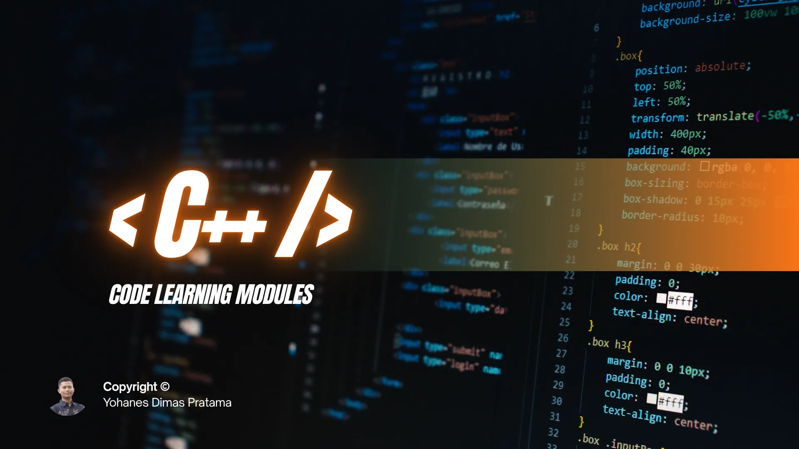

# CPP Learning Modules




## Project Overview

CPP Learning Modules is a structured, module-based C++ programming curriculum organized into 17 sequential modules and 250 standalone runnable submodules. Designed for progressive skill development from foundational syntax to modern C++20 features and engineering practices, each module pairs concise bilingual-commented source code (252 `.cpp` files and 2 `.h` headers) with a dedicated module guide and 250 verified PNG execution output renders generated from actual compiled binaries.

## Learning Objectives

The curriculum aims to build systematic proficiency in modern C++ development through incremental, executable examples rather than abstract theory alone. Upon completing the modules, learners are expected to understand and apply the following practical competencies:

- Write well-structured C++ programs using standard I/O streams, type-safe variables, operators, control flow, and modular functions.
- Manage memory safely by contrasting raw pointers and dynamic allocation (`new`/`delete`) with RAII and smart pointers (`unique_ptr`, `shared_ptr`, `weak_ptr`).
- Model real-world domains with user-defined types (`struct`, `enum class`, `union`) and Object-Oriented Programming principles including encapsulation, inheritance, polymorphism, and abstract interfaces.
- Leverage Standard Template Library (STL) containers, iterators, algorithms, and generic templates (including C++20 concepts) for reusable, idiomatic code.
- Implement core data structures and algorithms—searching, sorting, linked lists, trees, hash tables, graphs (BFS/DFS), backtracking, and dynamic programming—with Big-O awareness.
- Adopt modern C++17/C++20 capabilities (`std::optional`, `std::variant`, `std::filesystem`, `std::chrono`, move semantics, multithreading, ranges, and coroutines) alongside assertions, boundary testing, multi-file compilation, and interactive console applications.

## Learning Level & Approach

The repository follows a progressive, self-contained module-based approach where almost every submodule has its own `main()` entry point so learners can compile and observe concepts in isolation before combining them in multi-file builds and capstone projects. Module documentation (`README.md` inside each module folder) is written in Indonesian, while C++ identifiers and standard library constructs prepare learners for industry-standard C++20 workflows.

| Attribute | Description |
| :--- | :--- |
| Learning Level | Beginner to Advanced (progressive across 17 sequential modules) |
| Learning Approach | Module-Based and Practice-Based (standalone `.cpp` lessons + 10 capstone projects) |
| Learning Format | Module Markdown guides, executable `.cpp`/`.h` source files, and rendered PNG execution outputs |
| Programming Focus | C++20, Standard Library (STL), Memory Management, OOP, Algorithms, and Software Quality |
| Compilation Standard | Microsoft Visual C++ (`cl`) targeting `/std:c++20` with `/EHsc /W4 /utf-8` |

## Learning Path & Curriculum

The curriculum progresses sequentially across 17 numbered modules organized into three major capability tiers: foundational syntax and procedural logic (Modules 01–06), memory management, OOP, STL, and generic/file programming (Modules 07–13), and algorithms, modern C++20 features, testing/build engineering, and practical console projects (Modules 14–17).

1. **Foundations & Procedural C++ (Modules 01–06):** Program anatomy, variables and types, operators and I/O, branching, loops, and functions including recursion and lambdas.
2. **Memory, Abstraction & Standard Library (Modules 07–13):** Arrays, strings, `std::vector`, raw and smart pointers, RAII, user-defined types, full OOP, STL containers/algorithms, templates/concepts, and file/exception handling.
3. **Algorithms, Modern C++20 & Applied Engineering (Modules 14–17):** Searching/sorting, trees/graphs/DP, C++17/20 features and concurrency, debugging/testing/multi-file builds, and 10 end-to-end console projects.

| Order | Module | Main Topics | Materials |
| :---: | :--- | :--- | :--- |
| 01 | [Pengenalan C++ dan Struktur Program](module-01-pengenalan-cpp-dan-struktur-program/README.md) | Hello world, program anatomy, comments, `cout`, `std`, warnings, preprocessor | 10 `.cpp`, 10 `.png`, Guide |
| 02 | [Variabel dan Tipe Data](module-02-variabel-dan-tipe-data/README.md) | Variables, primitives, `string`, `const`/`constexpr`, casting, `auto`, scope | 14 `.cpp`, 14 `.png`, Guide |
| 03 | [Input, Output, dan Operator](module-03-input-output-dan-operator/README.md) | `cin`, `getline`, input validation, arithmetic/logical/bitwise ops, `iomanip` | 14 `.cpp`, 14 `.png`, Guide |
| 04 | [Percabangan dan Pengambilan Keputusan](module-04-percabangan-dan-pengambilan-keputusan/README.md) | `if`, `if-else`, `switch-case`, ternary, grading, leap year, calculator | 10 `.cpp`, 10 `.png`, Guide |
| 05 | [Perulangan](module-05-perulangan/README.md) | `for`, `while`, `do-while`, `break`/`continue`, patterns, primes, Fibonacci | 15 `.cpp`, 15 `.png`, Guide |
| 06 | [Fungsi](module-06-fungsi/README.md) | Parameters, prototypes, overloading, pass-by-value/ref, recursion, lambdas | 15 `.cpp`, 15 `.png`, Guide |
| 07 | [Array, String, dan Koleksi Data](module-07-array-string-dan-koleksi-data/README.md) | 1D/2D arrays, matrix math, `std::string`, C-strings, `std::vector` | 19 `.cpp`, 19 `.png`, Guide |
| 08 | [Pointer dan Pengelolaan Memori](module-08-pointer-dan-pengelolaan-memori/README.md) | Addresses, pointer arithmetic, `nullptr`, `new`/`delete`, smart pointers, RAII | 15 `.cpp`, 15 `.png`, Guide |
| 09 | [Struktur Data Buatan Pengguna](module-09-struktur-data-buatan-pengguna/README.md) | `struct`, array of structs, `enum`, `enum class`, `using`, `union`, nested struct | 9 `.cpp`, 9 `.png`, Guide |
| 10 | [Object-Oriented Programming (OOP)](module-10-object-oriented-programming-oop/README.md) | Classes, constructors, encapsulation, operator overloading, inheritance, polymorphism | 26 `.cpp`, 26 `.png`, Guide |
| 11 | [Standard Template Library (STL)](module-11-standard-template-library-stl/README.md) | `pair`, `tuple`, `list`, `deque`, `stack`, `queue`, `set`/`map`, iterators, algorithms | 23 `.cpp`, 23 `.png`, Guide |
| 12 | [Template dan Pemrograman Generik](module-12-template-dan-pemrograman-generik/README.md) | Function/class templates, specialization, variadic templates, C++20 concepts | 9 `.cpp`, 9 `.png`, Guide |
| 13 | [File Handling dan Exception Handling](module-13-file-handling-dan-exception-handling/README.md) | File read/write/append, CSV I/O, `try-catch`, `throw`, custom exceptions | 12 `.cpp`, 12 `.png`, Guide |
| 14 | [Algoritma dan Struktur Data](module-14-algoritma-dan-struktur-data/README.md) | Search, sorting, linked lists, BST, hash table, BFS/DFS, backtracking, DP, Big-O | 19 `.cpp`, 19 `.png`, Guide |
| 15 | [C++ Modern dan Fitur Lanjutan](module-15-cpp-modern-dan-fitur-lanjutan/README.md) | Structured bindings, `optional`/`variant`/`any`, move semantics, threads, ranges, coroutines | 18 `.cpp`, 18 `.png`, Guide |
| 16 | [Debugging, Testing, dan Kualitas Kode](module-16-debugging-testing-dan-kualitas-kode/README.md) | Debugging, `assert`, unit/boundary tests, UB/sanitizers, multi-file headers, namespaces | 14 `.cpp`, 2 `.h`, 12 `.png`, Guide |
| 17 | [Proyek Praktik](module-17-proyek-praktik/README.md) | 10 interactive console applications integrating OOP, STL, and validation | 10 `.cpp`, 10 `.png`, Guide |

## Learning Modules & Contents

Each module directory contains a dedicated `README.md` with compilation instructions, concept explanations, input examples, and embedded links to every submodule's `.cpp` file and `output/*.png` execution render. The index below provides direct navigation to each module's guide, output folder, and key source files.

### Module 01 — Pengenalan C++ dan Struktur Program

- **Module Guide & Outputs:** [Module 01 README](module-01-pengenalan-cpp-dan-struktur-program/README.md) | [Execution Outputs](module-01-pengenalan-cpp-dan-struktur-program/output)
- **Submodules (`01`–`10`):** Covers first program setup ([`01_hello_world.cpp`](module-01-pengenalan-cpp-dan-struktur-program/01_hello_world.cpp)), basic program structure ([`02_struktur_program.cpp`](module-01-pengenalan-cpp-dan-struktur-program/02_struktur_program.cpp)), comments, escape sequences, `cout`, `std` namespace, output formatting ([`07_format_output.cpp`](module-01-pengenalan-cpp-dan-struktur-program/07_format_output.cpp)), compile errors, compiler warnings, and preprocessor directives ([`10_preprocessor.cpp`](module-01-pengenalan-cpp-dan-struktur-program/10_preprocessor.cpp)).

### Module 02 — Variabel dan Tipe Data

- **Module Guide & Outputs:** [Module 02 README](module-02-variabel-dan-tipe-data/README.md) | [Execution Outputs](module-02-variabel-dan-tipe-data/output)
- **Submodules (`11`–`24`):** Covers variable declaration/initialization ([`11_variable.cpp`](module-02-variabel-dan-tipe-data/11_variable.cpp)), integer/float/`char`/`bool`/`string` types, `const` and `constexpr` ([`19_constant_constexpr.cpp`](module-02-variabel-dan-tipe-data/19_constant_constexpr.cpp)), implicit conversion and `static_cast` ([`21_type_casting.cpp`](module-02-variabel-dan-tipe-data/21_type_casting.cpp)), `auto` type deduction, variable scope, and `numeric_limits` ([`24_numeric_limits.cpp`](module-02-variabel-dan-tipe-data/24_numeric_limits.cpp)).

### Module 03 — Input, Output, dan Operator

- **Module Guide & Outputs:** [Module 03 README](module-03-input-output-dan-operator/README.md) | [Execution Outputs](module-03-input-output-dan-operator/output)
- **Submodules (`25`–`38`):** Covers `std::cin`, `std::getline`, input validation ([`27_input_validation.cpp`](module-03-input-output-dan-operator/27_input_validation.cpp)), arithmetic, assignment, comparison, logical, increment/decrement, modulus, precedence, ternary, bitwise operators ([`36_bitwise_operators.cpp`](module-03-input-output-dan-operator/36_bitwise_operators.cpp)), `<cmath>` functions, and `<iomanip>` formatting ([`38_iomanip_formatting.cpp`](module-03-input-output-dan-operator/38_iomanip_formatting.cpp)).

### Module 04 — Percabangan dan Pengambilan Keputusan

- **Module Guide & Outputs:** [Module 04 README](module-04-percabangan-dan-pengambilan-keputusan/README.md) | [Execution Outputs](module-04-percabangan-dan-pengambilan-keputusan/output)
- **Submodules (`39`–`48`):** Covers `if`, `if-else`, `else-if`, nested `if`, `switch-case` ([`43_switch_case.cpp`](module-04-percabangan-dan-pengambilan-keputusan/43_switch_case.cpp)), ternary decision logic, grade classification, even/odd checking, leap year rules, and a simple branching calculator ([`48_simple_calculator.cpp`](module-04-percabangan-dan-pengambilan-keputusan/48_simple_calculator.cpp)).

### Module 05 — Perulangan

- **Module Guide & Outputs:** [Module 05 README](module-05-perulangan/README.md) | [Execution Outputs](module-05-perulangan/output)
- **Submodules (`49`–`63`):** Covers `for`, `while`, `do-while`, nested loops, `break`/`continue`, counters, cumulative sums, factorial calculation ([`57_factorial_loop.cpp`](module-05-perulangan/57_factorial_loop.cpp)), multiplication tables, number and star patterns, primality testing ([`61_prime_number.cpp`](module-05-perulangan/61_prime_number.cpp)), Fibonacci generation, and a loop-based guessing game ([`63_guessing_game.cpp`](module-05-perulangan/63_guessing_game.cpp)).

### Module 06 — Fungsi

- **Module Guide & Outputs:** [Module 06 README](module-06-fungsi/README.md) | [Execution Outputs](module-06-fungsi/output)
- **Submodules (`64`–`78`):** Covers basic functions, parameters, return values, `void` functions, prototypes, default arguments, function overloading ([`70_function_overloading.cpp`](module-06-fungsi/70_function_overloading.cpp)), pass-by-value, pass-by-reference, `const` references, recursion (factorial and Fibonacci), lambda expressions ([`77_lambda_function.cpp`](module-06-fungsi/77_lambda_function.cpp)), and function pointers ([`78_function_pointer.cpp`](module-06-fungsi/78_function_pointer.cpp)).

### Module 07 — Array, String, dan Koleksi Data

- **Module Guide & Outputs:** [Module 07 README](module-07-array-string-dan-koleksi-data/README.md) | [Execution Outputs](module-07-array-string-dan-koleksi-data/output)
- **Submodules (`79`–`97`):** Covers 1D arrays, input/iteration, sum/average, min/max, array search and sorting ([`85_array_sorting.cpp`](module-07-array-string-dan-koleksi-data/85_array_sorting.cpp)), multidimensional arrays, matrix addition and multiplication ([`88_matrix_multiplication.cpp`](module-07-array-string-dan-koleksi-data/88_matrix_multiplication.cpp)), `std::string` methods/search/manipulation, C-style strings, and `std::vector` basics, sorting, and object collections ([`97_vector_of_objects.cpp`](module-07-array-string-dan-koleksi-data/97_vector_of_objects.cpp)).

### Module 08 — Pointer dan Pengelolaan Memori

- **Module Guide & Outputs:** [Module 08 README](module-08-pointer-dan-pengelolaan-memori/README.md) | [Execution Outputs](module-08-pointer-dan-pengelolaan-memori/output)
- **Submodules (`98`–`112`):** Covers memory addresses, pointer basics, dereferencing, pointers and arrays, pointer arithmetic, `nullptr`, pointer parameters, references vs. pointers, dynamic allocation (`new`/`delete` and dynamic arrays), smart pointers (`unique_ptr`, `shared_ptr`, `weak_ptr`), and RAII resource management ([`112_raii.cpp`](module-08-pointer-dan-pengelolaan-memori/112_raii.cpp)).

### Module 09 — Struktur Data Buatan Pengguna

- **Module Guide & Outputs:** [Module 09 README](module-09-struktur-data-buatan-pengguna/README.md) | [Execution Outputs](module-09-struktur-data-buatan-pengguna/output)
- **Submodules (`113`–`121`):** Covers `struct` definitions ([`113_struct_basic.cpp`](module-09-struktur-data-buatan-pengguna/113_struct_basic.cpp)), arrays of structs, structs as function parameters, unscoped `enum` and scoped `enum class` ([`117_enum_class.cpp`](module-09-struktur-data-buatan-pengguna/117_enum_class.cpp)), type aliases via `typedef`/`using`, `union`, nested structs, and a structured data record application ([`121_data_record.cpp`](module-09-struktur-data-buatan-pengguna/121_data_record.cpp)).

### Module 10 — Object-Oriented Programming (OOP)

- **Module Guide & Outputs:** [Module 10 README](module-10-object-oriented-programming-oop/README.md) | [Execution Outputs](module-10-object-oriented-programming-oop/output)
- **Submodules (`122`–`147`):** Covers classes and objects, access specifiers, constructors/overloading/destructors, member initializer lists, encapsulation, getters/setters, `this` pointer, static members, friend functions, operator overloading ([`135_operator_overloading.cpp`](module-10-object-oriented-programming-oop/135_operator_overloading.cpp)), single/multilevel/multiple inheritance, virtual functions, overriding, polymorphism ([`141_polymorphism.cpp`](module-10-object-oriented-programming-oop/141_polymorphism.cpp)), abstract classes, pure virtual destructors, composition, aggregation, and interface design ([`147_interface_design.cpp`](module-10-object-oriented-programming-oop/147_interface_design.cpp)).

### Module 11 — Standard Template Library (STL)

- **Module Guide & Outputs:** [Module 11 README](module-11-standard-template-library-stl/README.md) | [Execution Outputs](module-11-standard-template-library-stl/output)
- **Submodules (`148`–`170`):** Covers `std::pair`, `std::tuple`, advanced `vector`, `list`, `deque`, container adaptors (`stack`, `queue`, `priority_queue`), associative and unordered containers (`set`, `multiset`, `map`, `multimap`, `unordered_set`, `unordered_map`), iterators, range-based loops, and `<algorithm>`/`<numeric>` operations (`sort`, `find`, `count`, `transform`, `accumulate`, `remove_if`, and lambda predicates in [`170_stl_lambda.cpp`](module-11-standard-template-library-stl/170_stl_lambda.cpp)).

### Module 12 — Template dan Pemrograman Generik

- **Module Guide & Outputs:** [Module 12 README](module-12-template-dan-pemrograman-generik/README.md) | [Execution Outputs](module-12-template-dan-pemrograman-generik/output)
- **Submodules (`171`–`179`):** Covers function templates ([`171_function_template.cpp`](module-12-template-dan-pemrograman-generik/171_function_template.cpp)), multiple template parameters, class templates ([`173_class_template.cpp`](module-12-template-dan-pemrograman-generik/173_class_template.cpp)), template specialization, default template parameters, template type deduction, variadic templates ([`177_variadic_template.cpp`](module-12-template-dan-pemrograman-generik/177_variadic_template.cpp)), generic programming patterns, and C++20 concepts ([`179_concepts_intro.cpp`](module-12-template-dan-pemrograman-generik/179_concepts_intro.cpp)).

### Module 13 — File Handling dan Exception Handling

- **Module Guide & Outputs:** [Module 13 README](module-13-file-handling-dan-exception-handling/README.md) | [Execution Outputs](module-13-file-handling-dan-exception-handling/output)
- **Submodules (`180`–`191`):** Covers file output/input/append, line-by-line reading, stream validation, CSV reading/writing ([`185_csv_read_write.cpp`](module-13-file-handling-dan-exception-handling/185_csv_read_write.cpp)), exception fundamentals, `try-catch`, `throw`, custom exception classes ([`189_custom_exception.cpp`](module-13-file-handling-dan-exception-handling/189_custom_exception.cpp)), input error recovery, and basic file data persistence ([`191_file_data_persistence.cpp`](module-13-file-handling-dan-exception-handling/191_file_data_persistence.cpp)).

### Module 14 — Algoritma dan Struktur Data

- **Module Guide & Outputs:** [Module 14 README](module-14-algoritma-dan-struktur-data/README.md) | [Execution Outputs](module-14-algoritma-dan-struktur-data/output)
- **Submodules (`192`–`210`):** Covers linear/binary search, sorting algorithms (bubble, selection, insertion, merge, quick sort in [`198_quick_sort.cpp`](module-14-algoritma-dan-struktur-data/198_quick_sort.cpp)), singly/doubly linked lists, binary trees, binary search trees, tree traversals, hash tables, graph representations, BFS ([`206_graph_bfs.cpp`](module-14-algoritma-dan-struktur-data/206_graph_bfs.cpp)), DFS, backtracking, dynamic programming ([`209_dynamic_programming.cpp`](module-14-algoritma-dan-struktur-data/209_dynamic_programming.cpp)), and Big-O complexity timing ([`210_big_o_analysis.cpp`](module-14-algoritma-dan-struktur-data/210_big_o_analysis.cpp)).

### Module 15 — C++ Modern dan Fitur Lanjutan

- **Module Guide & Outputs:** [Module 15 README](module-15-cpp-modern-dan-fitur-lanjutan/README.md) | [Execution Outputs](module-15-cpp-modern-dan-fitur-lanjutan/output)
- **Submodules (`211`–`228`):** Covers C++17 structured bindings, `std::optional`, `std::variant`, `std::any`, `std::filesystem`, `std::chrono`, `<random>`, move semantics, rvalue references, perfect forwarding, copy/move constructors, Rule of Three/Five/Zero ([`223_rule_of_three_five_zero.cpp`](module-15-cpp-modern-dan-fitur-lanjutan/223_rule_of_three_five_zero.cpp)), multithreading with `std::thread`, `std::mutex`, `std::async`/`std::future`, C++20 ranges ([`227_cpp20_ranges.cpp`](module-15-cpp-modern-dan-fitur-lanjutan/227_cpp20_ranges.cpp)), and coroutines ([`228_coroutines_intro.cpp`](module-15-cpp-modern-dan-fitur-lanjutan/228_coroutines_intro.cpp)).

### Module 16 — Debugging, Testing, dan Kualitas Kode

- **Module Guide & Outputs:** [Module 16 README](module-16-debugging-testing-dan-kualitas-kode/README.md) | [Execution Outputs](module-16-debugging-testing-dan-kualitas-kode/output)
- **Submodules (`229`–`240`):** Covers basic debugging, `assert`, unit testing functions ([`231_unit_testing_basic.cpp`](module-16-debugging-testing-dan-kualitas-kode/231_unit_testing_basic.cpp)), edge-case and boundary testing, undefined behavior awareness, sanitizer examples, refactoring, header/source separation ([`237_header_files.cpp`](module-16-debugging-testing-dan-kualitas-kode/237_header_files.cpp), [`237_perhitungan.h`](module-16-debugging-testing-dan-kualitas-kode/237_perhitungan.h), [`237_perhitungan.cpp`](module-16-debugging-testing-dan-kualitas-kode/237_perhitungan.cpp)), multi-file linking ([`238_multi_file_program.cpp`](module-16-debugging-testing-dan-kualitas-kode/238_multi_file_program.cpp), [`238_pesan.h`](module-16-debugging-testing-dan-kualitas-kode/238_pesan.h), [`238_pesan.cpp`](module-16-debugging-testing-dan-kualitas-kode/238_pesan.cpp)), custom namespaces, and CLI argument handling (`argc`/`argv`).

### Module 17 — Proyek Praktik

- **Module Guide & Outputs:** [Module 17 README](module-17-proyek-praktik/README.md) | [Execution Outputs](module-17-proyek-praktik/output)
- **Submodules (`241`–`250`):** Integrates core language features, OOP classes, STL containers, and console I/O validation across 10 end-to-end mini-projects summarized in the section below.

## Projects & Coding Challenges

Module 17 provides 10 self-contained interactive console capstone applications (`241`–`250`), each accompanied by documented sample inputs and verified PNG execution outputs in [`module-17-proyek-praktik/output`](module-17-proyek-praktik/output).

| Project | Learning Focus | Source Code |
| :--- | :--- | :--- |
| Console Calculator | `switch-case` dispatch, arithmetic validation, zero-division guard | [`241_calculator_project.cpp`](module-17-proyek-praktik/241_calculator_project.cpp) |
| Student Grade Manager | `std::vector` of records, average calculation, pass/fail status | [`242_student_grade_project.cpp`](module-17-proyek-praktik/242_student_grade_project.cpp) |
| Student Database | `std::map` CRUD operations (add, search, delete, list by ID) | [`243_student_database_project.cpp`](module-17-proyek-praktik/243_student_database_project.cpp) |
| Inventory System | Stock tracking with `std::map` and over-withdrawal prevention | [`244_inventory_system_project.cpp`](module-17-proyek-praktik/244_inventory_system_project.cpp) |
| Cashier System | Iterative line-item totals and payment change validation | [`245_cashier_system_project.cpp`](module-17-proyek-praktik/245_cashier_system_project.cpp) |
| Bank Account Simulator | Class encapsulation (`Rekening`), deposit/withdrawal bounds checks | [`246_bank_account_project.cpp`](module-17-proyek-praktik/246_bank_account_project.cpp) |
| Library Management System | Book catalog state tracking for borrow and return workflows | [`247_library_management_project.cpp`](module-17-proyek-praktik/247_library_management_project.cpp) |
| Employee Management System | Employee salary directory with create, update, delete, list | [`248_employee_management_project.cpp`](module-17-proyek-praktik/248_employee_management_project.cpp) |
| Expense Tracker | Category-based expense logging and cumulative reporting | [`249_expense_tracker_project.cpp`](module-17-proyek-praktik/249_expense_tracker_project.cpp) |
| Terminal Guessing Game | Bounded random target generation with 5-turn feedback loop | [`250_terminal_game_project.cpp`](module-17-proyek-praktik/250_terminal_game_project.cpp) |

## Programming Languages & Tech Stack

| Category | Technology | Purpose |
| :--- | :--- | :--- |
| Primary Language | C++ (C++20 standard) | Core programming language taught across all 250 submodules |
| Standard Library | C++ Standard Library & STL | Containers, iterators, algorithms, smart pointers, `<filesystem>`, `<chrono>`, `<ranges>`, `<thread>` |
| Compiler Toolchain | Microsoft Visual C++ (`cl`) | Compiling single-file and multi-file submodules with `/std:c++20 /EHsc /W4 /utf-8` |
| Development Shell | Developer Command Prompt for VS | Windows build environment documented across all module guides |
| Documentation | Markdown & PNG Output Renders | Module-level guides (`README.md`) and 250 captured execution output visuals |

## Prerequisites & Setup

Before compiling and running the submodules, ensure your local environment provides a C++20-compatible compiler toolchain:

- **Operating System:** Windows (documented commands target *Developer Command Prompt for VS*), or any OS with a C++20 compiler (`g++`/`clang++`) when adapting compiler flags.
- **Compiler Toolchain (Required):** Visual Studio or Build Tools for Visual Studio providing the MSVC `cl` compiler with C++20 support (`/std:c++20`).
- **Source Control (Optional):** Git to clone the repository locally.

1. Clone the repository and enter the project root directory:

```bash
git clone https://github.com/weztcy/CPP-Learning-Modules.git
cd "CPP Learning Modules"
```

2. Open **Developer Command Prompt for VS** from the Start Menu and navigate to the cloned repository root before compiling any module file.

## Code Execution & Usage

Every main `.cpp` file (except the two helper implementation files `237_perhitungan.cpp` and `238_pesan.cpp`) defines its own `main()` function and is compiled one submodule at a time.

1. **Compile and run any standalone submodule** by replacing `<module-folder>` and `<file.cpp>` with the target submodule path:

```bat
cl /nologo /std:c++20 /EHsc /W4 /utf-8 /Fe:"%TEMP%\latihan.exe" <module-folder>\<file.cpp>
"%TEMP%\latihan.exe"
```

Example for Module 01 (`01_hello_world.cpp`):

```bat
cl /nologo /std:c++20 /EHsc /W4 /utf-8 /Fe:"%TEMP%\latihan.exe" module-01-pengenalan-cpp-dan-struktur-program\01_hello_world.cpp
"%TEMP%\latihan.exe"
```

2. **Compile and run multi-file submodules in Module 16** (submodules `237` and `238` require linking their companion `.cpp` implementation files):

```bat
cl /std:c++20 /EHsc /W4 /Fe:"%TEMP%\latihan.exe" module-16-debugging-testing-dan-kualitas-kode\237_header_files.cpp module-16-debugging-testing-dan-kualitas-kode\237_perhitungan.cpp
"%TEMP%\latihan.exe"

cl /std:c++20 /EHsc /W4 /Fe:"%TEMP%\latihan.exe" module-16-debugging-testing-dan-kualitas-kode\238_multi_file_program.cpp module-16-debugging-testing-dan-kualitas-kode\238_pesan.cpp
"%TEMP%\latihan.exe"
```

3. **Provide interactive input where required:** Submodules in Modules 03, 04, 05, 07, and 17 read from `std::cin`; consult each module's `README.md` for verified sample inputs (where `|` denotes pressing Enter between entries) and run file-writing examples in Module 13 inside an isolated practice folder. Note that `234_undefined_behavior.cpp` and `235_sanitizer_example.cpp` document safety boundaries—only modify commented unsafe lines inside an isolated sanitizer build.

## Contributing

Contributions that enhance lesson clarity, expand test coverage, or improve module documentation are welcome. Follow this workflow when proposing changes:

1. Fork the repository.
2. Create a branch for the change.
3. Add or improve learning materials, source code, exercises, or documentation.
4. Verify code examples and links where practical.
5. Commit and push the branch.
6. Open a pull request with a clear explanation.

## License

This project is licensed under the MIT License.
See the [LICENSE](LICENSE) file for details.

## Author & Contact

**Yohanes Dimas Pratama**

- GitHub: [github.com/weztcy](https://github.com/weztcy)
- Portfolio: [yohanesdimas.com](https://yohanesdimas.com)
- LinkedIn: [linkedin.com/in/yohanes-dimas](https://www.linkedin.com/in/yohanes-dimas)
